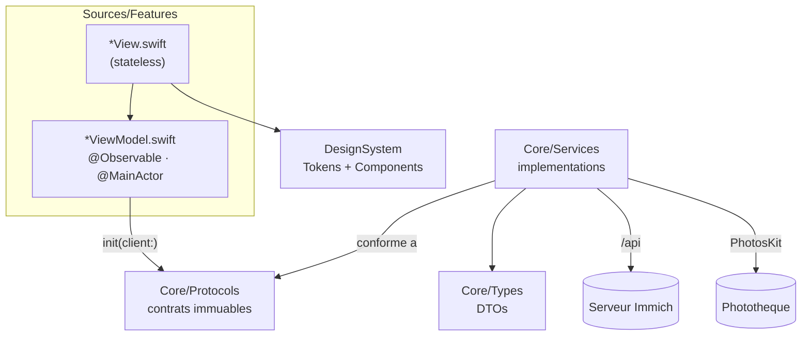

# ImmichSwiftUI

> Client iOS **natif** (SwiftUI) pour [Immich](https://github.com/immich-app/immich), la plateforme photo/vidéo auto-hébergée. Conçu pour **iOS 26** et son langage visuel Liquid Glass — ce n'est pas un port du client Flutter upstream.

ImmichSwiftUI s'appuie sur la même API serveur (`/api`) que le client officiel, avec la même ambition de parité fonctionnelle, mais réécrit pour une expérience 100 % Apple : SwiftUI, intégrations système profondes (Live Activities, Dynamic Island, widgets, App Intents, tâches d'arrière-plan) et une sauvegarde conçue pour de vraies photothèques (streaming disque, RAM bornée).

---

## Sommaire

- [Pourquoi une app native ?](#pourquoi-une-app-native-)
- [Fonctionnalités](#fonctionnalités)
- [Architecture](#architecture)
- [Comment l'app fonctionne](#comment-lapp-fonctionne)
- [Démarrage rapide](#démarrage-rapide)
- [Tests](#tests)
- [Release (App Store)](#release-app-store)
- [Contribuer](#contribuer)

---

## Pourquoi une app native ?

1. **Expérience native.** Le client upstream est en Flutter : excellente parité multiplateforme, mais pas de langage visuel iOS. ImmichSwiftUI suit les HIG et le Liquid Glass d'iOS 26, avec `NavigationStack`, tab bar et sheets natifs.
2. **Intégrations système.** Une Live Activity affiche la progression du backup dans la Dynamic Island et sur l'écran verrouillé ; BGTaskScheduler entretient une chaîne de sauvegardes en arrière-plan ; un App Intent expose « Back up now » à Siri/Shortcuts ; un widget d'accueil lance un backup en un tap.
3. **Performance face aux vraies photothèques.** Le backup est entièrement streamé disque→réseau : hash SHA-1 par blocs, multipart écrit sur disque, upload par fichier. La RAM reste bornée quelle que soit la taille de l'asset — les grosses vidéos iCloud ne tuent pas l'app.
4. **Souveraineté.** Self-hosted, zéro cloud intermédiaire : l'app ne parle qu'à ton serveur Immich.

La parité avec le client Flutter est suivie dans [`docs/mobile-features-vs-flutter.md`](docs/mobile-features-vs-flutter.md).

## Fonctionnalités

| Domaine | Contenu | Code |
|---|---|---|
| **Timeline** | buckets par jour, zoom de grille, vignettes | `Sources/Features/Timeline/` |
| **Visionneuse** | plein écran, zoom, filmstrip, vidéo, diaporama, panneau EXIF, stacks, visages | `Sources/Features/PhotoViewer/` |
| **Recherche** | sémantique (CLIP), lieux (carte), filtres par personnes, tags, « hors album », favoris et archive, recherche de texte dans le nom de fichier ou la description, densité de grille réglée dans les préférences, sélection multiple des résultats avec les actions de lot de la timeline | `Sources/Features/Search/` |
| **Albums** | CRUD, partage, flux d'activité | `Sources/Features/Albums/` |
| **Personnes, tags, doublons, corbeille** | gestion des visages, tags, détection de doublons, restauration | `Sources/Features/People/`, `Tags/`, `Duplicates/`, `Trash/` |
| **Liens partagés** | CRUD, mot de passe, expiration, **visionneuse publique** (ouvrir un lien reçu, le déverrouiller, le parcourir, upload invité) | `Sources/Features/SharedLinks/` |
| **Souvenirs** | « Ce jour-là », visionneuse de moments | `Sources/Features/Memories/` |
| **Éditeur photo** | recadrage, rotation, édition non destructive | `Sources/Features/Editor/` |
| **RoadTrip** | lecteur + export d'un film de voyage (ouverture → diaporama → trajet carte) généré depuis un album | `Sources/Features/RoadTrip/` |
| **Auto-backup** | streaming, dédup serveur, Live Activity, arrière-plan, reprise | `Sources/Features/Upload/` + `Sources/Services/BackupEngine.swift` |
| **Admin** | panneau d'administration serveur | `Sources/Features/Admin/` |
| **Profil** | stockage, verrouillage de l'app (Face ID), choix de la langue | `Sources/Features/Profile/` |
| **Langue** | anglais (source) + français, allemand, espagnol, italien ; suit l'appareil par défaut, épinglable dans l'app, dates localisées | `Resources/Localizable.xcstrings` + `Sources/Features/Settings/` |

Extensions : widget d'accueil « Back up now » (`ImmichWidgets/`), Live Activity de backup (Dynamic Island), App Intent `BackupNowAppIntent` (Siri/Shortcuts).

## Architecture

MVVM strict en 4 couches. Les protocoles de `Core/Protocols/` sont **immuables** et constituent le seul point d'injection ; tout le reste est implémentation ou présentation.

| Couche | Rôle | Contenu |
|---|---|---|
| `Sources/Core/Types/` | DTOs de l'API | `DTOs*.swift`, `SearchDTOs.swift`, `APIError.swift`, … |
| `Sources/Core/Protocols/` | Contrats (seul point d'injection) | `ImmichClient`, `PhotoLibraryService`, `BackupAssetSource`, `BackupLedgerStoring`, `KeychainStore`, `TrustedServerStore`, `AppLockService`, `VideoPlaybackEngine` |
| `Sources/Services/` | Implémentations | `ImmichAPIClient`, `PhotoLibraryServiceImpl`, `BackupEngine`, `BackupLedger`, `MultipartBody`, `ImageCache`, `AuthenticatedAsyncImage`, `RealtimeService` (Socket.IO), `KeychainStoreImpl`, … |
| `Sources/Features/<Feature>/` | MVVM par feature | `<Feature>ViewModel.swift` (`@Observable`, `@MainActor`) + `<Feature>View.swift` (stateless) |

Points de composition :

- **`Sources/DependencyContainer.swift`** — composition root : singleton `@MainActor`, méthodes `make*ViewModel()` qui injectent les protocoles via `init(client:)`. Aucun view model partagé.
- **`Sources/RootView.swift`** — routeur auth-gated : onboarding → `AuthenticatedRoot` (TabView). Un changement de compte détruit le sous-arbre complet (`.id(activeAccountID)`), zéro état résiduel.
- **`Sources/DesignSystem/`** — `Tokens/` (`Color.immich*`, `bgPrimary`/`bgSecondary`, spacing, motion, fonts) + `Components/` (barre d'app, boutons, badges, squelettes). Aucune couleur en dur dans les vues.
- **`Sources/ImmichSharedKit/`** — framework partagé app ⇄ extension widget : attributs et vues ActivityKit de la Live Activity.
- **`ImmichWidgets/`** — extension widget (tuile d'accueil + Live Activity).



## Comment l'app fonctionne

### Authentification

1. Onboarding : URL du serveur (saisie ou scan de QR code) → ping `/api/server/ping` + configuration serveur.
2. Connexion email/mot de passe (`/api/auth/login`) ou OAuth2/OIDC (`ASWebAuthenticationSession`, callback `app.immich:///oauth-callback`).
3. Token stocké dans le Keychain ; à chaque lancement, `restoreSession()` revalide le token et reconstruit la session.
4. App Lock (Face ID) : verrouillage au passage en arrière-plan, overlay `LockView`.

### Données et images

- **`ImmichAPIClient`** : toutes les URLs passent par `ImmichAPI.SubPath` ; token en en-tête ; client thread-safe ; erreurs typées `APIError`.
- **Images** : `AuthenticatedAsyncImage`, pipeline à 3 niveaux (cache mémoire actor-isolé `NSCache`, cache disque, réseau avec en-têtes d'authentification).
- **Temps réel** : `RealtimeService` (Socket.IO) pour les événements serveur.

### Sauvegarde automatique — la pièce maîtresse

`BackupEngine` est une machine à phases : `checking → uploading → done / cancelled`.

1. **Scan** de la photothèque (PhotosKit) avec filtres (screenshots, Camera Roll, WhatsApp).
2. **Passe 1 — hash** : SHA-1 streamé par blocs de 1 Mo ; jamais l'asset entier en RAM.
3. **Déduplication serveur** : `/api/assets/bulk-upload-check`.
4. **Passe 2 — upload** : ré-export sur disque → multipart écrit sur disque → `URLSession.upload(fromFile:)`. RAM bornée, les grosses vidéos sont sauvegardées au lieu d'être écartées.
5. **`BackupLedger`** : les assets déjà sauvegardés ne sont pas ré-exportés — évite de re-télécharger toute la photothèque iCloud « Optimiser le stockage » à chaque run.
6. **Assets iCloud** : états dédiés (téléchargement en cours, retry) avec messages de statut dans l'UI.

Progression fiable : total fixé après filtrage, barre = `processed / total` (chaque asset compte : uploadé, dédupliqué ou échoué).

Surfaces système :

- **Live Activity** (`BackupLiveActivityService`) — progression dans la Dynamic Island et l'écran verrouillé.
- **BGTaskScheduler** — chaîne auto-entretenue de backups en arrière-plan (`app.immich.background-backup`).
- **App Intent** — « Back up now » depuis Siri/Shortcuts ; le widget d'accueil le déclenche via le deep link `app.immich://backup`.

### Navigation

`AuthenticatedRoot` : TabView (Photos, Memories, Albums, Shared) + onglet Recherche natif iOS 26 (`role: .search`, bulle Liquid Glass alignée par le système). Le profil (« Me ») est présenté en sheet depuis l'avatar de chaque onglet.

## Démarrage rapide

### Prérequis

- Xcode avec SDK iOS 26
- [XcodeGen](https://github.com/yonaskolb/XcodeGen) — `project.yml` est la source de vérité du projet ; `ImmichSwiftUI.xcodeproj` est **généré**.

```bash
xcodegen generate
open ImmichSwiftUI.xcodeproj
# choisir un simulateur (iPhone 17, iOS 26), puis ⌘R
```

Au premier lancement : URL de ton instance Immich (ou scan du QR code), puis connexion. N'importe quel serveur Immich récent convient.

## Tests

```bash
xcodebuild test -destination 'platform=iOS Simulator,name=iPhone 17'
```

- 886 tests dans `Tests/` (dernier relevé : 2026-09-14, `-only-testing:ImmichSwiftUITests`) ; chaque view model est testé avec un `MockImmichClient` injecté via `init(client:)`.
- **Piège** : le target de test source le dossier `Tests/` en entier — un nouveau fichier `Tests/*.swift` n'est compilé qu'après `xcodegen generate`. Sans regénération, les tests passent « verts » par omission.

### CI et IPA signé

```bash
Scripts/ci.sh            # ce que lance la CI : xcodegen generate, build des deux bundles de test, tests unitaires, scénarios UI listés
Scripts/ipa.sh [version] # archive Release + IPA signé Apple Distribution dans build/ipa/Swimmich.ipa
```

- **CI** (`.github/workflows/ci.yml`) lance `Scripts/ci.sh` à chaque push, sur n'importe quelle branche, sur un Mac auto-hébergé (labels `self-hosted, macOS, ARM64, xcode`). Elle garde DerivedData dans `~/Library/Caches/swimmich-ci` : un run ne recompile que ce qui a changé. Le job `Unit tests (iOS simulator)` est le check qu'exige `main`. Il n'y a pas de déclencheur `pull_request` : la pull request d'un fork n'exécute jamais de code sur ce Mac.
- **Pool de simulateurs :** les tests unitaires et les scénarios UI listés dans `Scripts/ci-ui-scenarios.txt` tournent côte à côte sur un pool de simulateurs dédié (`SWIMMICH_CI_UI_WORKERS`, 3 par défaut : `swimmich-ci-ui-1`, `-ui-2`, `-ui-3`, créés à la première utilisation), un job par simulateur à la fois. Un simulateur est réinitialisé entre deux jobs (app désinstallée, trousseau vidé, autorisations révoquées, taille de texte remise à L), pas effacé : un simulateur effacé passe ses premières minutes à reconstruire fonds d'écran, widgets et Photos, et en effacer un par ligne occupait tout le Mac. Avec [simslim](https://github.com/MobAI-App/simslim) installé (`brew install mobai-app/tap/simslim`), chaque simulateur du pool est allégé avec `Scripts/simslim-ci.json` (démons d'arrière-plan inutiles aux tests désactivés) avant son démarrage ; sans lui, le pool tourne en configuration d'origine. Une réinitialisation garde Photos et l'enrôlement Face ID ; une ligne qui exige un appareil fraîchement effacé déclare `--erase`. Chaque ligne reçoit son propre stub de `UITests/stubs/` sur le port de son worker (8421, 8422, …), plus les prérequis d'appareil qu'elle déclare (`--content-size`, `--media`). Un test par ligne, la plus longue d'abord : le run dure au moins aussi longtemps que sa ligne la plus longue, donc un test UI de plus de 3 minutes reçoit un avertissement de CI et se découpe. Chaque ligne de la liste porte un palier (`Scripts/ci_ui_select.py`). Chaque push lance la gate (`SWIMMICH_CI_UI_SCOPE=gate`, moins de 5 minutes, build compris : `Scripts/ci.sh` affiche ses durées et avertit au-delà de `SWIMMICH_CI_GATE_BUDGET`) : d'abord les lignes que le push a pu casser (ligne nouvelle ou modifiée, ligne dont la fonction de test ou le stub a changé ; un helper modifié sélectionne sa classe, les seuls commentaires ne sélectionnent rien), puis les lignes `--smoke`, une ligne par simulateur que les tests unitaires laissent libre pour qu'aucun scénario n'attende derrière un autre (une ligne modifiée qui ne trouve pas de place reçoit un avertissement et est laissée à la suite de la nuit). Chaque nuit, `main` lance la suite core (`core`, environ 25 minutes) : les lignes smoke, les parcours de chaque feature et les scénarios qui sont l'unique preuve d'un critère. Les lignes `--release`, secondes preuves de critères que les tests unitaires prouvent déjà, tournent avec toutes les autres (`all`, environ 50 minutes) dimanche soir et sur un tag `v*` avant son IPA ; `all` est aussi ce que `Scripts/ci.sh` lance sur le Mac d'un développeur. Une seule suite tourne à la fois sur le Mac. La CI contrôle deux budgets (5 lignes smoke, 40 lignes dans la suite de la nuit) : un critère de détail va dans un test unitaire, un écran entier dans un test hébergé (`Tests/HostedScreen.swift`), pas dans un nouveau scénario. Un scénario qui échoue ou se saute lui-même fait échouer la CI. Les autres scénarios sont compilés, pas exécutés.
- **IPA signé** : sur `main`, une fois les tests passés, le job `Signed IPA` lance `Scripts/ipa.sh` et garde `Swimmich.ipa` comme artefact du workflow pendant 14 jours. La signature est automatique, par l'Apple ID connecté à Xcode sur le Mac du runner : si ce compte se déconnecte ou que sa session expire, le job échoue. Une clé API App Store Connect (`ASC_KEY_ID`, `ASC_ISSUER_ID`, `ASC_KEY_PATH`) la remplace quand elle est posée. Rien ne part vers App Store Connect depuis `main` ; sur un tag `v<version>`, c'est le job `App Store upload` qui archive, signe et envoie le build (voir [Release (App Store)](#release-app-store)). `Scripts/ipa.sh --upload` reste l'envoi manuel, depuis le Mac d'un développeur connecté avec un Apple ID. Tout IPA que produit `Scripts/ipa.sh` passe d'abord un contrôle de packaging : un seul `ImmichSharedKit.framework`, embarqué par l'app seule, et aucun dossier `Frameworks/` dans les deux extensions.
- **Piège du runner :** le LaunchAgent du runner ne doit pas poser `SessionCreate`. `svc.sh install` le pose, et codesign n'atteint alors plus le trousseau de login (`errSecInternalComponent`).

### Audit du catalogue de chaînes

```bash
python3 Scripts/i18n-audit.py
```

`Scripts/i18n-audit.py` garde `Resources/Localizable.xcstrings` contre ses quatre dérives : une clé du catalogue que plus aucune cible de build ne réclame (**morte**), une clé réclamée par le code et absente du catalogue (**manquante**), une clé réclamée sans traduction `fr`, `de`, `es` ou `it` (**non traduite**), et une clé qui formate un compteur entier (`%lld`, `%d`, `%2$lld`…) sans formes de pluriel (**pluriel**, règle R4). Son verdict vient d'une extraction réelle — un build sur DerivedData vierge avec `SWIFT_EMIT_LOC_STRINGS=YES` (~40 s, son propre DerivedData, déplaçable par `--derived-data <chemin>`) — et il ne modifie jamais ni le catalogue ni une source : il nomme les clés fautives, la correction reste manuelle. Codes de sortie : `0` les quatre ensembles sont vides, `1` au moins une clé fautive (listée par section), `2` outillage — `DEVELOPER_DIR` invalide, build en échec, extraction incomplète, catalogue illisible. Un `.swift` compilé sans son `.stringsdata` vaut une sortie `2`, jamais un verdict propre.

La règle R4 ne lit que le catalogue, sans build. Une clé comptée a des formes `one` et `other` non vides en `en`, `fr`, `de`, `es` et `it` (`variations.plural`) ou, quand elle compte plusieurs choses (`%lld photos · %lld videos`), une substitution plurielle par compteur (`%#@photos@ · %#@videos@`, `argNum` = la position du compteur). Une liste fermée de clés est exemptée — rapports « N sur M », pourcentages et huit nombres nus (`PLURAL_EXCEPTIONS`) — et une exception qui n'est aucune des trois est elle-même refusée. `python3 Scripts/i18n-audit.py --plurals-only` lance R4 seule (affiche `plural violations: <n>`, sortie `0`/`1`, `2` si le catalogue est illisible) et `--catalog <chemin>` audite un autre catalogue. `Scripts/test_i18n_audit.py` teste la règle (`python3 -m unittest discover -s Scripts -p 'test_*.py'`). `Scripts/ci.sh` les lance en premier, puis l'audit complet juste après `xcodegen` ; son verdict est appliqué en fin de script, et chaque ligne fautive devient une annotation `::error` publique.

## Release (App Store)

Pousser un tag `v<version>` fait archiver Swimmich en Release par la CI, la signe pour l'App Store et envoie le build à App Store Connect (TestFlight), sans geste manuel sur le Mac de CI. Tous les éléments sensibles viennent des secrets d'un Environment GitHub : rien de sensible n'est stocké dans le dépôt.

### Préalables

À faire une fois, par un humain :

- **Fiche de l'app.** L'app existe sur App Store Connect pour le bundle `fr.millianlmx.immich-ios` (les extensions `fr.millianlmx.immich-ios.widgets` et `fr.millianlmx.immich-ios.share-extension` n'ont pas de fiche propre).
- **Certificat.** Un certificat Apple Distribution de l'équipe `2MJF39L8VY`, avec sa clé privée, exporté en `.p12`.
- **Profils.** Trois profils de provisionnement de type App Store Connect, un par bundle (`fr.millianlmx.immich-ios`, `.widgets`, `.share-extension`), qui incluent chacun ce certificat.
- **Clé API.** Une clé API App Store Connect (clé d'équipe, rôle App Manager) : elle ne sert qu'à l'envoi.
- **Environment.** Un Environment GitHub nommé `app-store` (Settings › Environments › New environment `app-store` › Deployment branches and tags › Selected branches and tags › Add deployment branch or tag rule › type Tag, motif `v*`). Crée les 8 secrets ci-dessous dans cet Environment, pas en secrets de dépôt : un secret de dépôt est lisible par toute branche qui modifie `.github/workflows/ci.yml`, et ce workflow tourne à chaque push, sur un Mac partagé. Seul le job `App Store upload` déclare l'Environment : aucun autre job ne reçoit ces secrets.
- **Ruleset de tags (recommandé).** Settings › Rules › Rulesets › New tag ruleset, cible `v*`, règles Restrict creations, Restrict updates et Restrict deletions, contournement réservé aux admins du dépôt : seuls les mainteneurs peuvent alors créer un tag `v*`, donc déclencher un envoi.
- **Renouvellement.** Le certificat et les profils expirent au bout d'un an. Remplace-les en mettant à jour les secrets ; un tag poussé avec un profil expiré échoue et l'annotation nomme le secret.

### Secrets

Exactement les secrets que lit `.github/workflows/ci.yml`, dans l'Environment `app-store`. Pour mettre un fichier dans un secret, encode-le et copie le résultat : `base64 -i dist.p12 | pbcopy`.

| Secret | Contenu | Format | Où l'obtenir | Rôle Apple |
| --- | --- | --- | --- | --- |
| `APPLE_DISTRIBUTION_P12_BASE64` | Certificat Apple Distribution avec sa clé privée | Fichier `.p12` en base64 | Trousseaux d'accès › exporter l'identité en `.p12` ; certificat depuis Certificates, Identifiers & Profiles › Certificates | Account Holder ou Admin, ou App Manager avec accès aux certificats |
| `APPLE_DISTRIBUTION_P12_PASSWORD` | Mot de passe choisi à l'export du `.p12` | Texte brut | Choisi à l'export | Aucun |
| `PROFILE_APP_BASE64` | Profil App Store Connect de `fr.millianlmx.immich-ios`, incluant le certificat ci-dessus | Fichier `.mobileprovision` en base64 (`base64 -i <profil>.mobileprovision`) | Certificates, Identifiers & Profiles › Profiles | Mêmes rôles que le certificat |
| `PROFILE_WIDGETS_BASE64` | Profil App Store Connect de `fr.millianlmx.immich-ios.widgets` | Fichier `.mobileprovision` en base64 | Certificates, Identifiers & Profiles › Profiles | Mêmes rôles que le certificat |
| `PROFILE_SHARE_EXTENSION_BASE64` | Profil App Store Connect de `fr.millianlmx.immich-ios.share-extension` | Fichier `.mobileprovision` en base64 | Certificates, Identifiers & Profiles › Profiles | Mêmes rôles que le certificat |
| `ASC_KEY_ID` | Identifiant de la clé API | 10 caractères, lettres et chiffres | Users and Access › Integrations › App Store Connect API › Team Keys | App Manager (rôle de la clé) |
| `ASC_ISSUER_ID` | Identifiant de l'émetteur des clés API | UUID | Même page, au-dessus de la liste des clés | App Manager (rôle de la clé) |
| `ASC_KEY_P8_BASE64` | Le fichier de clé `AuthKey_<ID>.p8` | Fichier `.p8` en base64, téléchargeable une seule fois | Même page, à la création de la clé | App Manager (rôle de la clé) |

### Publier une release

```bash
git tag v1.2.3 && git push origin v1.2.3
```

- **Format du tag :** `v<major>`, `v<major>.<minor>` ou `v<major>.<minor>.<patch>`, nombres sans zéro initial. Le tag fixe la version marketing ; le numéro de build est l'heure UTC (`YYYYMMDD.HHMM`), qui ne fait que croître.
- **Contrôles d'abord.** Le run passe par `Unit tests (iOS simulator)`, puis la suite UI de release, puis `App Store upload`. Si un contrôle échoue, rien n'est envoyé.
- **Secret manquant.** `App Store upload` échoue avant l'archivage et nomme chaque secret manquant ou mal formé dans une annotation du run (les journaux du job peuvent être illisibles sans droits admin).
- **Signature.** `Scripts/release.sh` signe manuellement, depuis un trousseau temporaire et les trois profils : ni Apple ID, ni certificat ou profil créé côté Apple. Une annotation `Signing` affiche l'empreinte SHA-1 du certificat qui a signé l'app et ses deux extensions, et les UUID des profils. Le trousseau, les secrets décodés et les profils installés sont supprimés à la fin du job, échec compris.
- **`main`** produit toujours l'IPA en artefact, signé par l'Apple ID connecté à Xcode sur le Mac, et n'envoie rien.
- **IPA du tag.** Gardé en artefact `swimmich-ipa` pendant 14 jours.

### Après l'envoi

- **Suivre le build** dans App Store Connect › ton app › TestFlight ; le traitement prend quelques minutes. Le run se termine par une annotation `App Store Connect` une fois l'envoi fait.
- **Missing Compliance.** Tant que l'app ne déclare pas son chiffrement (la clé Info.plist ITSAppUsesNonExemptEncryption), chaque build attend en Missing Compliance : réponds au questionnaire de conformité export dans App Store Connect pour chaque build. C'est manuel.
- **Reste manuel :** la soumission du build à la review Apple et la mise en vente. Rien dans la chaîne ne fait l'un ni l'autre.

## Contribuer

Le développement suit une méthodologie par **cartes d'acceptance** (AC). Backlog : [`.omp/backlog/ImmichSwiftUI-backlog.md`](.omp/backlog/ImmichSwiftUI-backlog.md).

1. **Choisir une feature** dans le backlog (tableau de suivi, phases P0–P5, endpoints manquants).
2. **Lire les specs** : `.omp/<feature>/<feature>.specs.md` (exigences) et `<feature>.ui.md` (brief UI : navigation, tokens, comportements).
3. **Implémenter dans l'ordre** : protocole (`Core/Protocols/`) → service (`Services/`) → view model + vue (`Features/`) → design uniquement via les tokens `DesignSystem/`.
4. **Tester** avec un mock injecté, puis `xcodegen generate` et la suite complète.
5. **PR** : une feature = ses cartes AC cochées, ses specs mises à jour.

Conventions à respecter :

- **MVVM strict** : protocoles immuables, injection unique via `DependencyContainer`, view models `@Observable @MainActor` jamais partagés, vues stateless.
- **Navigation** : `NavigationStack` partout pour les écrans navigables.
- **Design** : tokens `DesignSystem` uniquement (`Color.immich*`, `bgPrimary`/`bgSecondary`) ; langage Liquid Glass iOS 26.
- **Tests** : un test défend un comportement observable (jamais l'implémentation, les valeurs par défaut ou le texte des mocks).
- **Mémoire projet** : voir `AGENTS.md` (mem0) — consulte la mémoire avant de débugger ou de trancher une convention.

### Documentation

| Doc | Contenu |
|---|---|
| `docs/mobile-features-vs-flutter.md` | Référence du client Flutter upstream (objectif de parité) |
| `docs/feature-parity-plan.md` | Plan de parité Flutter |
| `docs/app-review-ats.txt` | Justification App Review de `NSAllowsArbitraryLoads` (app, widget, Share Extension), à coller dans App Store Connect |
| `.omp/backlog/ImmichSwiftUI-backlog.md` | Backlog : phases, cartes AC, endpoints manquants |
| `.omp/<feature>/` | Specs + briefs UI + cartes d'acceptance par feature |
