# Swimmich

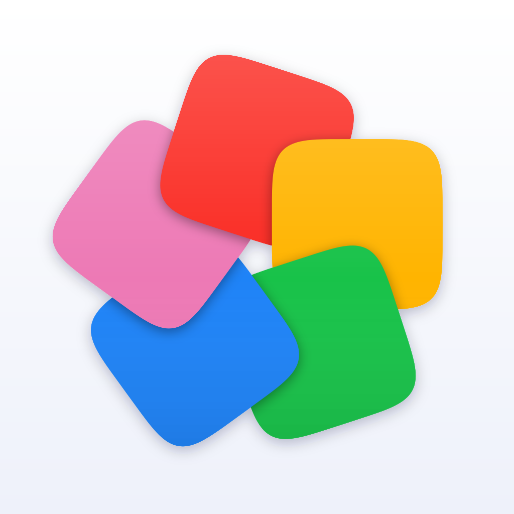

> **Swimmich** est une app iPhone native pour [Immich](https://github.com/immich-app/immich), la photothèque que l’on héberge soi-même. Vos photos restent sur votre serveur ; Swimmich les rend rapides à parcourir, sûres à sauvegarder et amusantes à partager.

  <a href="docs/media/swimmich.mp4">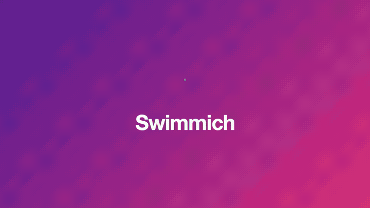</a>
   <a href="docs/media/swimmich.mp4">Voir la vidéo complète</a> · <a href="README.md">English</a> · <a href="docs/TECHNICAL.fr.md">Documentation technique</a>

---

## Pourquoi Swimmich

- **Pensée pour l’iPhone.** Une vraie app iOS, conçue pour iOS 26 et son style Liquid Glass : onglets, gestes, feuilles et retours haptiques natifs.
- **Vos photos, votre serveur.** Aucun cloud entre les deux : Swimmich parle à votre serveur Immich, et à rien d’autre.
- **Une sauvegarde qui suit.** Photothèques énormes, longues vidéos, photos encore dans iCloud : tout est sauvegardé, en arrière-plan, avec la progression dans la Dynamic Island.
- **Faite pour partager.** Un album devient un film de voyage, une recherche un reel, une année une story.

## Toute votre photothèque

Chaque photo et vidéo de votre serveur, dans une timeline qui suit votre pouce. Cherchez par ce que montre une photo, par qui y figure ou par l’endroit où elle a été prise ; parcourez vos albums, vos proches et vos souvenirs.

| Photos | Visionneuse | Recherche |
|:-:|:-:|:-:|
| 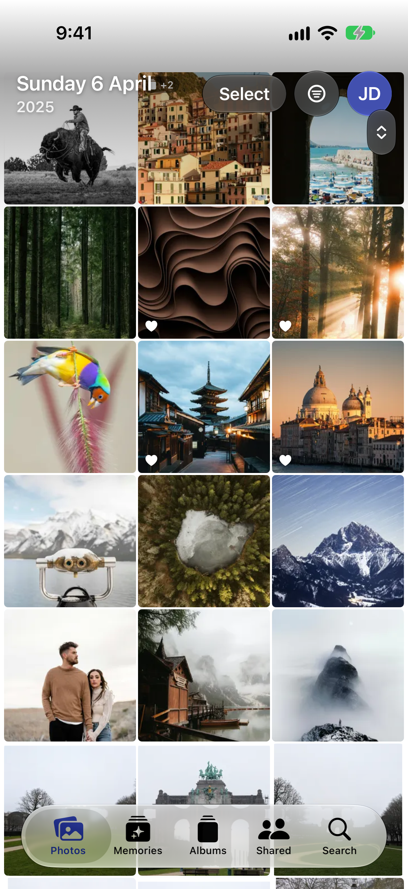 | 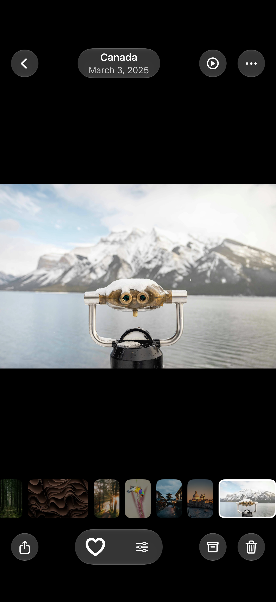 | 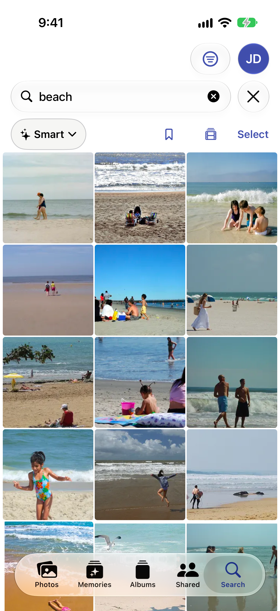 |

| Personnes | Carte | Souvenirs |
|:-:|:-:|:-:|
| 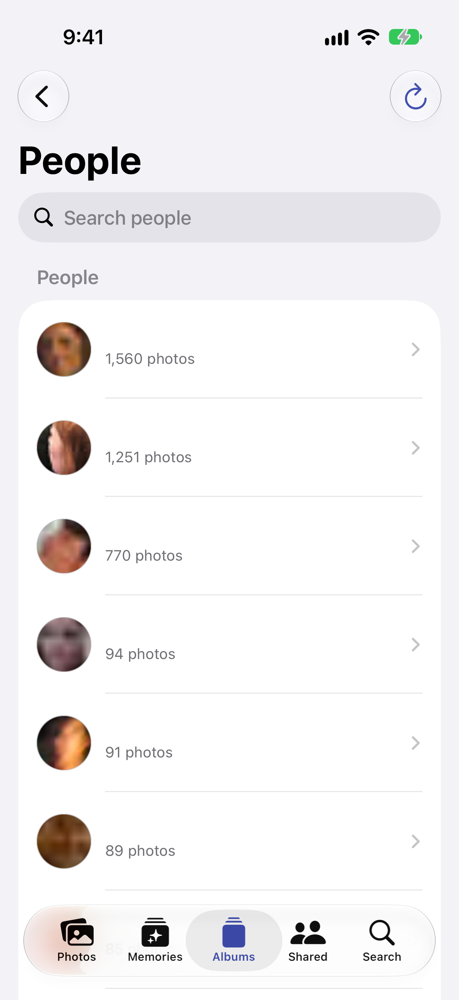 | 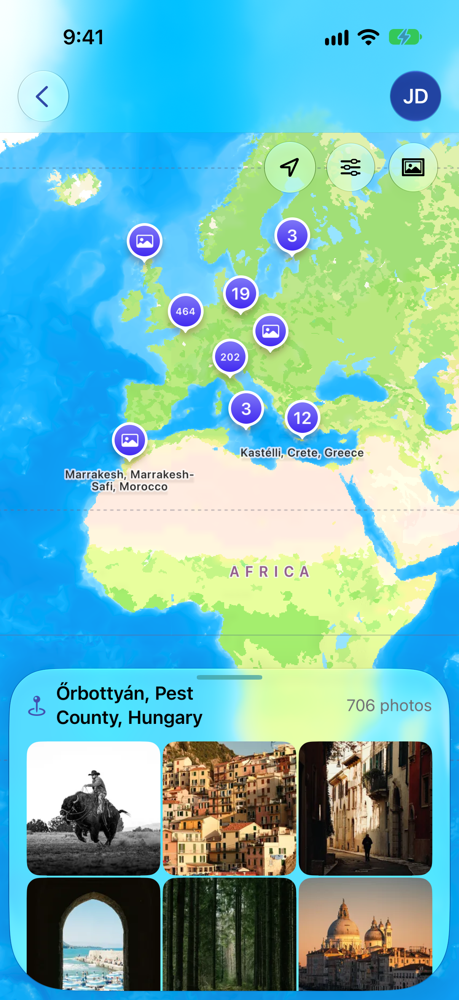 | 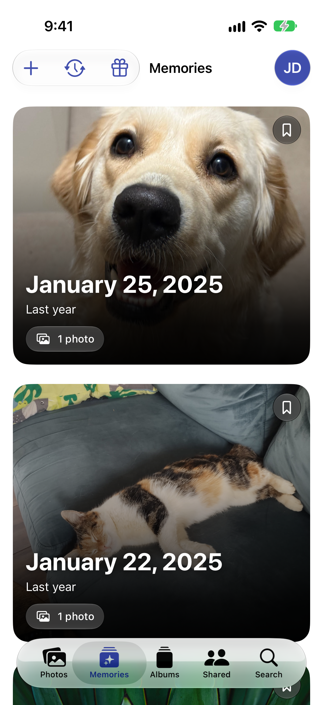 |

## Créer de quoi partager

Swimmich transforme vos photos en choses à publier, d’un toucher, sur votre téléphone. Tout est fabriqué sur votre iPhone depuis votre propre serveur : rien n’est envoyé ailleurs.

### Road Trip

Choisissez l’album d’un voyage : Swimmich trouve les étapes, trace la route sur une carte satellite et fait rouler une petite voiture de l’une à l’autre, avec les meilleures photos de chaque lieu. Enregistrez-le en vidéo verticale.

### Reel

Cherchez n’importe quoi, « plage », « neige », « chien », et obtenez chaque résultat en reel monté sur le tempo, avec un carton titre, l’année et le lieu sur chaque photo. Marche aussi avec un album ou une sélection.

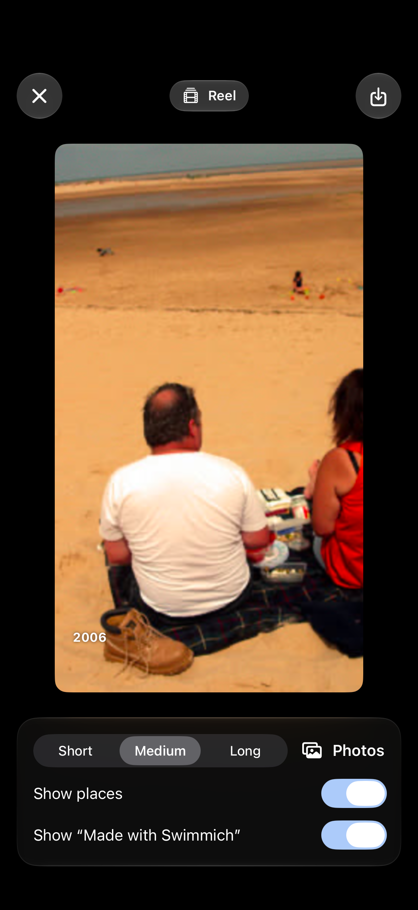

### Grandir

Choisissez une personne : Swimmich retrouve son visage au fil des années et l’aligne œil sur œil, pour qu’une décennie défile en quelques secondes. Ajoutez son anniversaire et son âge s’affiche sous chaque visage.

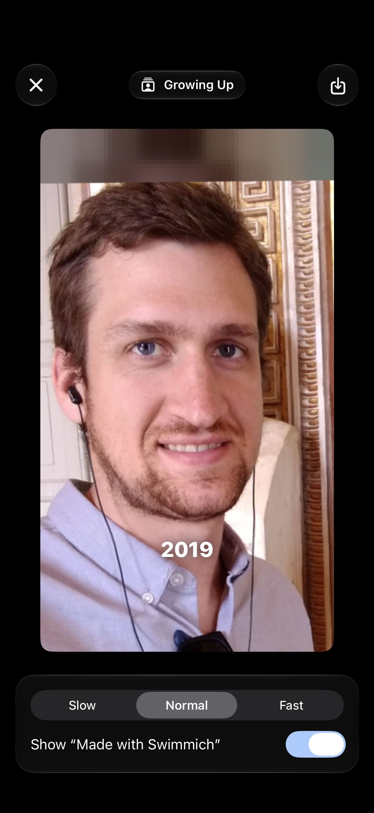

### Avant / après

Les lieux où vous êtes revenu, des années plus tard. Faites glisser le doigt sur l’image pour passer d’une année à l’autre, choisissez les photos, enregistrez la paire en image ou en vidéo.

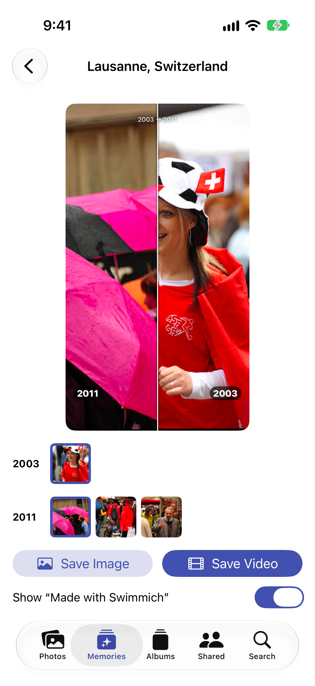

### Mosaïque de couleurs, Photo dump et Partout où je suis allé

| Mosaïque de couleurs | Photo dump | Partout où je suis allé |
|:-:|:-:|:-:|
| 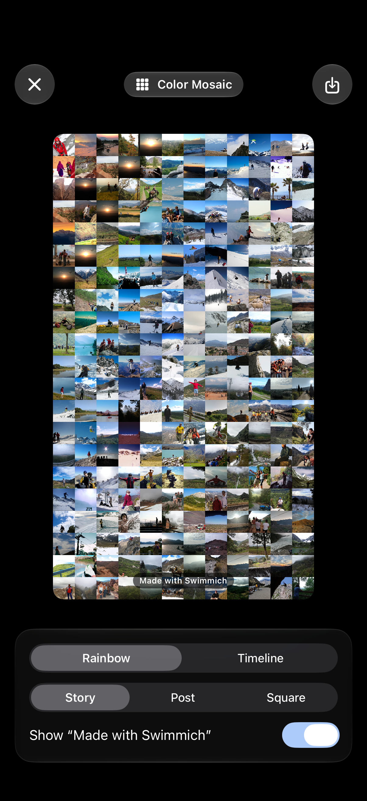 | 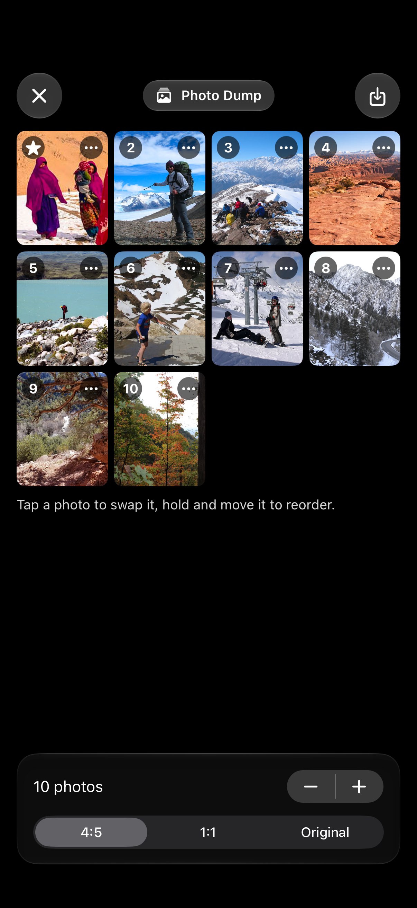 | 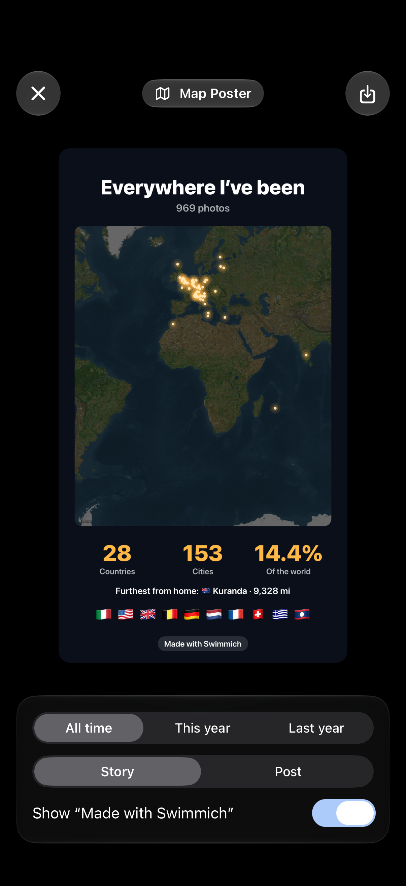 |
| Un album en une image, trié par couleur | Les dix meilleures, choisies pour vous, prêtes à publier | Chaque lieu photographié, sur une affiche |

### Wrapped

Votre année en photos, en story : votre mois le plus chargé, vos proches, vos lieux, votre année en couleurs et vos meilleures photos. Partagez-la en images ou en une vidéo.

| | | |
|:-:|:-:|:-:|
| 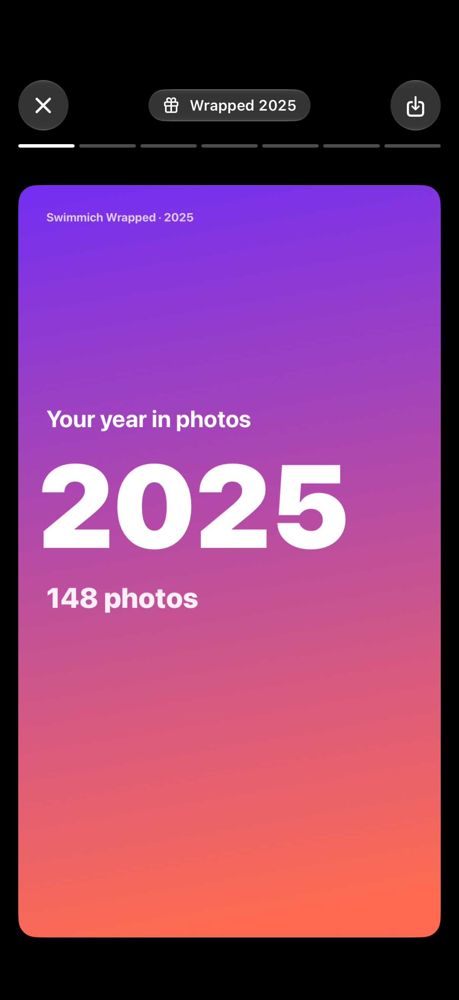 | 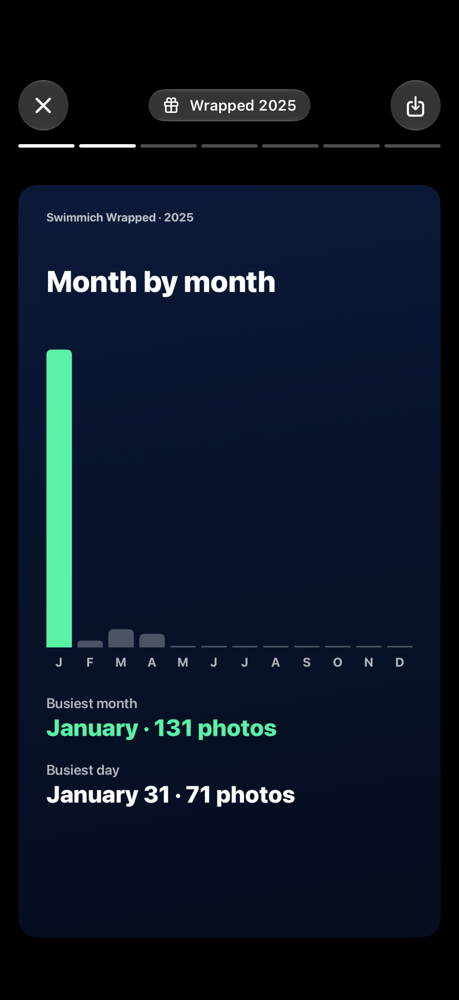 | 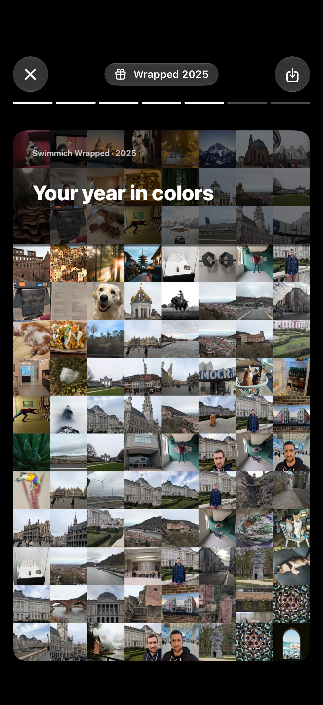 |

## Une sauvegarde qui suit

- **Automatique, en arrière-plan.** Les nouvelles photos partent seules sur votre serveur ; la progression s’affiche dans la Dynamic Island et sur l’écran verrouillé.
- **Faite pour de vraies photothèques.** Des dizaines de milliers de photos, de longues vidéos 4K et des photos encore dans iCloud sont toutes sauvegardées, sans saturer la mémoire.
- **Jamais deux fois.** Les photos que votre serveur a déjà sont ignorées, et celles déjà envoyées sont retenues.
- **Un toucher, partout.** « Sauvegarder maintenant » depuis un widget de l’écran d’accueil, Siri ou Raccourcis.

## Et tout le reste

Des copies hors ligne de vos photos préférées, des liens partagés avec mot de passe et date d’expiration, un dossier verrouillé derrière Face ID, le partage entre partenaires, un éditeur photo, les doublons et la corbeille, des widgets, la diffusion vers une TV, une adresse locale et une adresse externe du serveur, et l’app en anglais, français, allemand, espagnol et italien.

## Obtenir Swimmich

Il vous faut un iPhone sous iOS 26 et un serveur [Immich](https://github.com/immich-app/immich) joignable. Swimmich est gratuite et son code est sur GitHub ; pour l’instant, compilez-la avec Xcode : voir la [documentation technique](docs/TECHNICAL.fr.md#démarrage-rapide).

## Contribuer

Les idées, signalements de bugs et pull requests sont les bienvenus. Comment l’app est construite, testée et publiée, et comment travailler dessus : [documentation technique](docs/TECHNICAL.fr.md).

## Crédits

Swimmich est une app indépendante, sans lien avec le projet Immich. Les captures et la vidéo montrent la photothèque de démonstration publique d’Immich.
