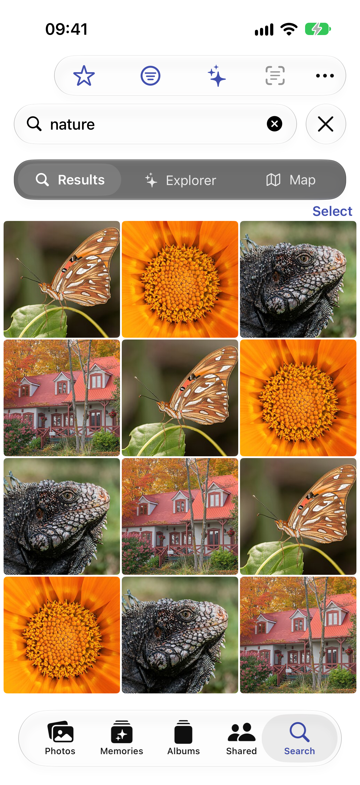
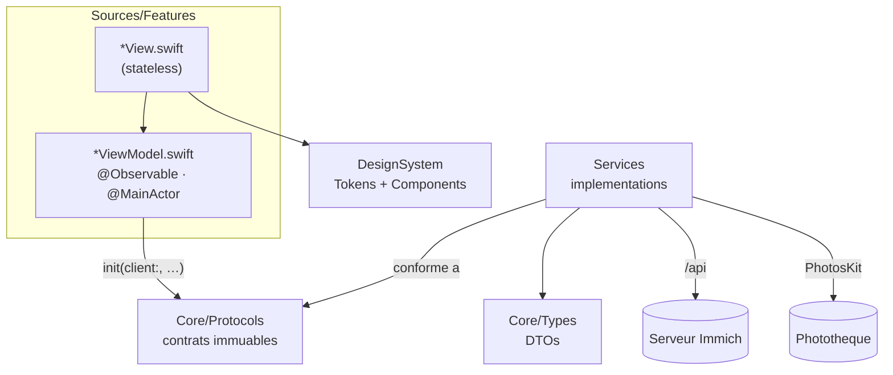

# Swimmich

> **Swimmich** est un client iOS **natif** (SwiftUI) pour [Immich](https://github.com/immich-app/immich), la plateforme photo/vidéo auto-hébergée. Conçu pour **iOS 26** et son langage visuel Liquid Glass — ce n'est pas un port du client Flutter upstream.

Swimmich s'appuie sur la même API serveur (`/api`) que le client Immich officiel, avec la même ambition de parité fonctionnelle, mais réécrit pour une expérience 100 % Apple : SwiftUI, intégrations système profondes (Live Activities, Dynamic Island, widgets, App Intents, tâches d'arrière-plan) et un moteur de sauvegarde conçu pour de vraies photothèques (streaming disque, RAM bornée). L'app s'appelle Swimmich sur l'écran d'accueil ; le projet Xcode, le scheme et les targets gardent le nom `ImmichSwiftUI`.

---

## Sommaire

- [Pourquoi une app native ?](#pourquoi-une-app-native-)
- [Fonctionnalités](#fonctionnalités)
- [Captures d'écran](#captures-décran)
- [Architecture](#architecture)
- [Comment l'app fonctionne](#comment-lapp-fonctionne)
- [Démarrage rapide](#démarrage-rapide)
- [Tests](#tests)
- [Release (App Store)](#release-app-store)
- [Contribuer](#contribuer)

---

## Pourquoi une app native ?

1. **Expérience native.** Le client upstream est en Flutter : excellente parité multiplateforme, mais pas de langage visuel iOS. Swimmich suit les HIG et le Liquid Glass d'iOS 26, avec `NavigationStack`, tab bar et sheets natifs.
2. **Intégrations système.** Une Live Activity affiche la progression de la sauvegarde dans la Dynamic Island et sur l'écran verrouillé ; BGTaskScheduler entretient une chaîne de sauvegardes en arrière-plan ; un App Intent expose « Back up now » à Siri/Shortcuts ; un widget d'accueil lance une sauvegarde en un tap.
3. **Performance face aux vraies photothèques.** La sauvegarde est entièrement streamée disque→réseau : SHA-1 calculé en streamant le fichier exporté par blocs de 64 Kio, multipart écrit sur disque, envoi depuis un fichier. La RAM reste bornée quelle que soit la taille de l'asset — les grosses vidéos iCloud ne tuent pas l'app.
4. **Souveraineté.** Self-hosted, pas de cloud intermédiaire : l'app parle à ton serveur Immich, à ton fournisseur SSO si tu t'y connectes, et aux services Apple (cartes MapKit, géocodage inverse).

La parité avec le client Flutter est suivie dans [`docs/mobile-features-vs-flutter.md`](docs/mobile-features-vs-flutter.md).

## Fonctionnalités

Chaque dossier de `Sources/Features/` figure une fois, dans la ligne de son domaine.

| Domaine | Contenu | Code |
|---|---|---|
| **Timeline** | photos groupées par jour, zoom de grille, scrubber de dates, sélection multiple avec actions de lot, listes « Recently Taken » et « Recently Added » | `Sources/Features/Timeline/`, `Sources/Features/Recent/` |
| **Visionneuse** | plein écran, zoom, filmstrip, vidéo, diaporama, panneau d'infos, surcouche de texte détecté, visages, stacks, ajustement de la date et du lieu, tags ; « Réessayer » sur une photo qui ne se charge pas et sur le panneau de détails ; retour haptique sur le favori et la suppression (suit le réglage Retour haptique) ; l'écran reste allumé tant que le diaporama est affiché ; une vidéo dont la copie hors ligne est illisible est lue depuis le flux transcodé du serveur | `Sources/Features/PhotoViewer/`, `Sources/Features/AssetDetail/` |
| **Diffusion** | feuille Cast et sélecteur de route AirPlay | `Sources/Features/Cast/` |
| **Recherche** | recherche sémantique (CLIP) et textuelle, filtres (personnes, tags, « hors album », favoris, archive, note, appareil, dates), carte, recherches enregistrées et récentes, sélection multiple des résultats | `Sources/Features/Search/` |
| **Albums** | création, édition, partage, flux d'activité, et la section Bibliothèque qui mène aux collections ci-dessous | `Sources/Features/Albums/` |
| **Personnes et tags** | gestion des visages avec anniversaires, tags hiérarchiques | `Sources/Features/People/`, `Sources/Features/Tags/` |
| **Dossiers et stacks** | vue des dossiers du serveur, stacks de photos | `Sources/Features/Folders/`, `Sources/Features/Stacks/` |
| **Doublons et corbeille** | revue des doublons, corbeille avec restauration | `Sources/Features/Duplicates/`, `Sources/Features/Trash/` |
| **Dossier verrouillé** | dossier privé derrière un code PIN à 6 chiffres vérifié par le serveur ; Face ID peut remplir ce PIN | `Sources/Features/LockedFolder/` |
| **Partenaires** | partage entre partenaires : invitations et photothèque du partenaire | `Sources/Features/Partners/` |
| **Liens partagés** | création, mot de passe, expiration, **visionneuse publique** (ouvrir un lien reçu, le déverrouiller, le parcourir, envoi invité) | `Sources/Features/SharedLinks/` |
| **Souvenirs** | « Ce jour-là », visionneuse de moments | `Sources/Features/Memories/` |
| **Hors ligne** | téléchargement des originaux dans un cache durable, consultation serveur injoignable, budget de stockage et éviction, panneau de progression des téléchargements | `Sources/Features/Offline/`, `Sources/Features/DownloadPanel/`, `Sources/Services/OfflineAssetStore.swift` |
| **Éditeur photo** | recadrage, rotation, miroir, enregistré comme liste d'éditions de la photo sur les serveurs qui le permettent, comme copie sinon | `Sources/Features/Editor/` |
| **RoadTrip** | lecteur et export d'un film de voyage (ouverture, diaporama, trajet sur la carte) généré depuis un album | `Sources/Features/RoadTrip/` |
| **Mosaïque de couleurs** | un album ou une sélection en une seule image, triée par couleur (arc-en-ciel) ou par date, exportée en story, publication ou carré avec une mention « Créé avec Swimmich » facultative | `Sources/Features/ColorMosaic/` |
| **Photo dump** | les meilleures photos d’un album ou d’une sélection pour un carrousel : réparties dans le temps, sans quasi-doublons, couverture en tête ; échange, réordonnancement, recadrées autour de leur sujet en 4:5 ou 1:1 et enregistrées dans l’ordre | `Sources/Features/PhotoDump/` |
| **Growing up** | un timelapse d’une personne au fil des années : une photo par tranche de temps, le visage aligné œil sur œil (cadres de visages d’Immich, repères Vision), son âge dessous quand elle a un anniversaire, exporté en vidéo verticale | `Sources/Features/GrowingUp/` |
| **Sauvegarde** | streaming, déduplication serveur, Live Activity, chaîne en arrière-plan, reprise, détail de l'envoi, « Remaining to back up », photothèque de l'appareil, état de synchronisation, libérer de l'espace | `Sources/Features/Upload/`, `Sources/Features/UploadDetail/`, `Sources/Features/BackupRemainder/`, `Sources/Features/LocalLibrary/`, `Sources/Features/SyncStatus/`, `Sources/Features/FreeUpSpace/`, `Sources/Services/BackupEngine.swift` |
| **Connexion et verrouillage** | onboarding, connexion par mot de passe et SSO, verrouillage de l'app (Face ID, avec le code de l'appareil en secours) | `Sources/Features/Auth/` |
| **Compte et sécurité** | profil et indicateur de stockage (hub « Me »), changement de mot de passe, sessions d'appareils, clés d'API, panneau d'administration du serveur | `Sources/Features/Profile/`, `Sources/Features/Security/`, `Sources/Features/UserApiKeys/`, `Sources/Features/Admin/` |
| **Réseau et confiance** | adresses locale et externe du serveur, en-têtes HTTP personnalisés (proxy), certificat client (TLS mutuel) | `Sources/Features/NetworkSettings/`, `Sources/Features/CustomHeaders/`, `Sources/Features/ClientCertificate/` |
| **Préférences et langue** | thème, haptique, qualité de partage, anglais (source) + français, allemand, espagnol, italien (suit l'appareil, épinglable dans l'app, dates localisées), réglages de notifications, mode lecture seule | `Sources/Features/Settings/`, `Sources/Features/Notifications/`, `Sources/Features/ReadOnly/`, `Resources/Localizable.xcstrings` |
| **Diagnostic et informations** | journal de l'app, statistiques des médias, dépannage d'un asset, « What's New », à propos et licences | `Sources/Features/AppUtilities/`, `Sources/Features/WhatsNew/`, `Sources/Features/About/` |

Extensions : widgets d'accueil et Live Activity de sauvegarde (`ImmichWidgets/`), extension de partage (`ImmichShareExtension/`), App Intent `BackupNowAppIntent` (Siri et Shortcuts).

## Captures d'écran

Prises sur un simulateur iPhone 17 contre un stub local qui sert des photos d'exemple CC0 (`UITests/stubs/fixtures/readme/`) : aucune photo, adresse de serveur ou compte personnels. La photothèque du simulateur reçoit les mêmes photos CC0, et l'écran Sauvegarde est pris au repos, accès Photos accordé, sans aucune vignette.

| Photos | Visionneuse | Albums |
|:-:|:-:|:-:|
|  |  |  |

| Recherche | Sauvegarde |
|:-:|:-:|
|  |  |

Pour les régénérer, sur un Mac avec Xcode (simulateur iOS 26), XcodeGen et python3 :

```bash
Scripts/screenshots.sh
```

Le script crée un simulateur jetable, démarre `UITests/stubs/immich_stub_readme_screenshots.py` sur un port libre et vérifie que ce port répond à ce stub et à aucun autre serveur, ajoute les photos CC0 à la photothèque du simulateur, installe l'app et lui accorde l'accès Photos avec `simctl privacy`, lance le scénario `ReadmeScreenshotsUITests` et réécrit les cinq fichiers de `docs/screenshots/`. Commite le résultat. Quand un push n'a pas l'un des cinq fichiers, le job de CI `README screenshots` les prend sur le runner et les publie sur la branche `ci/readme-screenshots` ; commite-les sous `docs/screenshots/`.

## Architecture

MVVM strict en 4 couches. Les protocoles de `Sources/Core/Protocols/` sont **immuables** et constituent le principal point d'injection ; quelques stores communs à tout le processus sont injectés tels quels ; tout le reste est implémentation ou présentation.

| Couche | Rôle | Contenu |
|---|---|---|
| `Sources/Core/Types/` | DTOs de l'API | `SearchDTOs.swift`, `APIError.swift`, `DTOs+SharedLink.swift`, … |
| `Sources/Core/Protocols/` | Contrats (principal point d'injection) | `ImmichClient`, `PhotoLibraryService`, `BackupAssetSource`, `BackupLedgerStoring`, `BackupEditLedgerStoring`, `KeychainStore`, `TrustedServerStore`, `AppLockService`, `VideoPlaybackEngine`, `IdleTimerControlling` |
| `Sources/Services/` | Implémentations | `ImmichAPIClient`, `PhotoLibraryServiceImpl`, `BackupEngine`, `BackupLedger`, `BackupEditLedger`, `ImageCache`, `AuthenticatedAsyncImage`, `RealtimeService` (Socket.IO), `KeychainStoreImpl`, … |
| `Sources/Features/<Feature>/` | MVVM par feature | `<Feature>ViewModel.swift` (`@Observable`, `@MainActor`) + `<Feature>View.swift` (stateless) |

Points de composition :

- **`Sources/DependencyContainer.swift`** — composition root : singleton `@MainActor`, méthodes `make*ViewModel()` qui injectent ce dont chaque view model a besoin : le plus souvent un protocole via `init(client:)`, parfois un store commun à tout le processus (`AppLogStore`, `WhatsNewStore`) ou le view model de l'écran qui l'ouvre (le reste à sauvegarder et le détail des envois prennent le `UploadViewModel`, l'info de téléchargement prend le `OfflineDownloadViewModel`).
- **`Sources/RootView.swift`** — routeur auth-gated : onboarding → `AuthenticatedRoot` (TabView). Un changement de compte détruit le sous-arbre complet (`.id(activeAccountID)`), zéro état résiduel.
- **`Sources/DesignSystem/`** — `Tokens/` (`Color.immich*`, `bgPrimary`/`bgSecondary`, spacing, motion, fonts) + `Components/` (barre d'app, boutons, badges, squelettes, contrôles flottants : `pvFloating(.circle|.pill|.bar)` au-dessus des photos, `pvGlass(…)` — le verre adaptatif du système — au-dessus de la carte). Les couleurs viennent de ces tokens ; quelques vues de feature utilisent encore des couleurs SwiftUI littérales (`Color.white`, `Color.red`…), à migrer, pas à copier.
- **`Sources/ImmichSharedKit/`** — framework partagé app ⇄ extensions : attributs et vues ActivityKit de la Live Activity, session des widgets, `MultipartBody` (corps d'envoi écrits sur disque).
- **`ImmichWidgets/`** — extension widget (widgets d'accueil + Live Activity). **`ImmichShareExtension/`** — extension de partage.



## Comment l'app fonctionne

### Authentification

1. **Onboarding :** URL du serveur (saisie ou scan de QR code) → ping `/api/server/ping` + configuration serveur. Un avis non bloquant prévient quand la version du serveur est inférieure à 2.0.0 ou à partir de 4.0.0.
2. **Connexion :** l'étape de connexion n'affiche que les modes que le serveur accepte : `GET /api/public/config` sur un serveur qui la sert (v3.2+), l'ancienne `GET /api/server/features` sinon. Mot de passe (`/api/auth/login`), SSO — OAuth2/OIDC via `ASWebAuthenticationSession` — ou les deux ; un serveur qui n'en accepte aucun le dit. Une connexion par mot de passe d'un non-administrateur dont le serveur pose `shouldChangePassword` passe par l'étape de changement de mot de passe avant l'accueil ; tant que le changement n'a pas réussi, le token reste en mémoire seulement.
3. **Stockage du token et lancement :** le token est stocké dans le Keychain. Un lancement avec une session enregistrée ouvre l'onglet Photos aussitôt ; `restoreSession()` valide le token derrière (un 401 ramène à l'étape de connexion, « session expirée »).
4. **App Lock (Face ID ou code) :** verrouillage au passage en arrière-plan, avec l'overlay `AppLockCoverView`.

### Données et images

- **`ImmichAPIClient`** : toutes les URLs passent par `ImmichAPI` ; token en en-tête ; client thread-safe ; erreurs typées `APIError`.
- **Images :** `AuthenticatedAsyncImage`, pipeline à 4 niveaux (copie hors ligne si présente, cache mémoire `ImageCache`, cache disque, réseau avec en-têtes d'authentification).
- **Temps réel :** `RealtimeService` (Socket.IO, `RealtimeTransport` injectable) pour les événements serveur. Chaque rafale debouncée poste `.immichAssetsChanged` avec le nom de ses événements (`RealtimeBatch`) : les listes Photos, Albums, Personnes, Souvenirs et Hors ligne se rechargent, et la visionneuse relit sa photo quand une retouche est régénérée.
- **En-têtes HTTP personnalisés (proxy) :** paires nom/valeur déclarées par serveur depuis l'étape serveur de l'onboarding ou Me › Advanced. Elles vivent dans le Keychain du groupe partagé (`KeychainCustomHeadersStore`), jamais dans les journaux, et chaque requête vers ce serveur les porte (`CustomHeadersRegistry`), widgets et extension de partage compris. Une redirection vers un autre hôte les abandonne (`ServerRedirectPolicy`). Un `401` portant `WWW-Authenticate` est le proxy qui refuse (`APIError.proxyRejected`) : la session est gardée.
- **Certificat client (authentification TLS mutuelle) :** un fichier PKCS#12 importé par serveur depuis l'étape serveur de l'onboarding ou Me › Advanced. L'identité vit dans le Keychain du groupe partagé (`KeychainClientIdentityStore`) ; `ClientCertificateResponder` répond au défi TLS de chaque connexion de l'app, et `WidgetTrustDelegate` à ceux des widgets et de l'extension de partage. Un serveur qui demande un certificat que personne ne peut présenter donne `APIError.clientCertificateRequired`.
- **Adresse locale et externe du serveur :** Me › Advanced › Network déclare, par compte, une adresse locale, une adresse externe et une bascule automatique, désactivée par défaut (`ServerEndpointSwitch`). Bascule active, l'adresse locale n'est utilisée que si le serveur répond à `GET /api/server/ping` et `GET /api/server/version` avec la même version que l'adresse externe, en moins de 2 s ; sinon l'externe. Le compte garde une seule identité (`ServerAddressBook`) ; les widgets appliquent la même règle (`WidgetEndpointResolver`).

### Sauvegarde automatique — la pièce maîtresse

`BackupEngine` est une machine à phases : `checking → uploading → done / cancelled`.

1. **Scan** de la photothèque (PhotosKit) : toute la photothèque par défaut, ou seulement les albums que tu choisis ou exclus (albums intelligents compris : Captures d'écran, Selfies, Rafales, Vidéos).
2. **Passe 1 — hash :** SHA-1 streamé depuis le fichier exporté par blocs de 64 Kio ; jamais l'asset entier en RAM.
3. **Déduplication serveur :** `/api/assets/bulk-upload-check`.
4. **Passe 2 — envoi :** chaque asset accepté est envoyé depuis le fichier exporté pour la passe 1 (ni second export, ni second téléchargement iCloud) : corps multipart écrit sur disque, puis envoi depuis le fichier. RAM bornée, les grosses vidéos sont sauvegardées au lieu d'être écartées.
5. **`BackupLedger` :** les assets déjà sauvegardés ne sont pas ré-exportés — évite de re-télécharger toute la photothèque iCloud « Optimiser le stockage » à chaque exécution.
6. **Assets iCloud :** états dédiés (téléchargement en cours, nouvel essai) avec messages de statut dans l'UI.
7. **Sauvegarder aussi les éditions (opt-in, désactivé par défaut) :** un asset édité sur place dans Photos voit son rendu édité exporté, envoyé sous le même `deviceAssetId`, puis empilé sur son original avec `POST /api/stacks`. Les éditions déjà envoyées sont consignées par `BackupEditLedger`, à côté du registre des originaux.

Progression fiable : total fixé après filtrage ; la barre vaut `(processed + ½ × staged) / total`, où processed = envoyé, déjà sur le serveur, échoué ou différé (original iCloud pas encore local), et staged = exporté et haché, en attente de son envoi.

Surfaces système :

- **Live Activity** (`LiveActivityBackupService`) — progression dans la Dynamic Island et l'écran verrouillé.
- **BGTaskScheduler** — chaîne auto-entretenue de sauvegardes en arrière-plan (`app.immich.background-backup`).
- **App Intent** — « Back up now » depuis Siri/Shortcuts ; le widget d'accueil le déclenche via le deep link `app.immich://backup`, qui lance une passe de sauvegarde manuelle sur l'onglet Photos.

### Navigation

`AuthenticatedRoot` : TabView (Photos, Memories, Albums, Shared) + onglet Recherche natif iOS 26 (`role: .search`). L'onglet Albums s'ouvre sur une section **Bibliothèque** : les collections de contenu (Recently Taken, Recently Added, People, Tags, Folders, Stacks, Partners, On this device, Offline Storage, Duplicates, Trash, Locked Folder), un toucher chacune, poussées sur la `NavigationStack` propre de l'onglet. L'onglet Photos est toute la photothèque : les photos de cet appareil que le serveur n'a pas encore y sont mêlées par date, avec un nuage barré (une photo que le serveur a déjà est reconnue à sa date de prise et montrée une fois), et s'y sauvegardent, se partagent ou se suppriment (Préférences › Afficher les photos de cet appareil). Favoris et Archive sont le bouton de filtre de l'onglet Photos ; les lieux sont Explorer, l'accueil de la Recherche tant qu'aucune recherche n'a eu lieu (la carte s'ouvre depuis l'aperçu de carte en tête ; une recherche par filtres seuls part du bouton Filtres, et Retour ou le ✕ du champ ramènent à Explorer). Le profil (« Me ») est présenté en sheet depuis l'avatar de chaque onglet — l'avatar porte aussi l'anneau de progression de la sauvegarde, et le statut de synchronisation est la première ligne du hub — et ne garde que le compte, les réglages et les outils.

## Démarrage rapide

### Prérequis

- Xcode avec SDK iOS 26
- [XcodeGen](https://github.com/yonaskolb/XcodeGen) — `project.yml` est la source de vérité du projet ; `ImmichSwiftUI.xcodeproj` est **généré**.

```bash
xcodegen generate
open ImmichSwiftUI.xcodeproj
# choisir un simulateur (iPhone 17, iOS 26), puis ⌘R
```

Au premier lancement : URL de ton instance Immich (ou scan du QR code), puis connexion. N'importe quel serveur Immich récent convient.

## Tests

```bash
xcodebuild test -project ImmichSwiftUI.xcodeproj -scheme ImmichSwiftUI -destination 'platform=iOS Simulator,name=iPhone 17' -only-testing:ImmichSwiftUITests
python3 -m unittest discover -s Scripts -p 'test_*.py'
```

- Les tests unitaires vivent dans `Tests/` : les view models sont testés avec un `MockImmichClient` injecté via `init(client:)`, ou avec la dépendance qu'ils prennent (`AdvancedSettingsViewModel` prend un journal et un cache d'images). Les scénarios UI de bout en bout vivent dans `UITests/Scenarios/`, chacun avec son stub Python sous `UITests/stubs/` ; `Scripts/ci.sh` lance ceux de `Scripts/ci-ui-scenarios.txt`.
- Les tests Python de `Scripts/` couvrent la CI, la chaîne de release, l'audit du catalogue de chaînes et ces README.
- **Piège** : le target de test source le dossier `Tests/` en entier — un nouveau fichier `Tests/*.swift` n'est compilé qu'après `xcodegen generate`. Sans regénération, les tests passent « verts » par omission.

### CI et IPA signé

```bash
Scripts/ci.sh            # ce que lance la CI : xcodegen generate, build des deux bundles de test, tests unitaires, scénarios UI listés
Scripts/ipa.sh [version] # archive Release + IPA signé Apple Distribution dans build/ipa/Swimmich.ipa
```

- **CI** (`.github/workflows/ci.yml`) lance `Scripts/ci.sh` à chaque push, sur n'importe quelle branche, sur un Mac auto-hébergé (labels `self-hosted, macOS, ARM64, xcode`). Elle garde DerivedData dans `~/Library/Caches/swimmich-ci` : un run ne recompile que ce qui a changé. Le job `Unit tests (iOS simulator)` est le check qu'exige `main`. Il n'y a pas de déclencheur `pull_request` : la pull request d'un fork n'exécute jamais de code sur ce Mac.
- **Search captures** : le job `Search captures` lance `Scripts/ci-search-captures.sh`. Ce script prend la série nommée par `Scripts/search-captures-series` (`before` ou `after`), soit 7 PNG de l'onglet Recherche, chacun avec sa mesure, puis les pousse avec un fichier SOURCE.txt sur la branche `ci/search-captures-<series>`. Seule la branche Git qui a créé une série peut la remplacer.
- **Pool de simulateurs :** les tests unitaires et les scénarios UI listés dans `Scripts/ci-ui-scenarios.txt` tournent côte à côte sur un pool de simulateurs dédié (`SWIMMICH_CI_UI_WORKERS`, 3 par défaut : `swimmich-ci-ui-1`, `-ui-2`, `-ui-3`, créés à la première utilisation), un job par simulateur à la fois. Un simulateur est réinitialisé entre deux jobs (app désinstallée, trousseau vidé, autorisations révoquées, taille de texte remise à L), pas effacé : un simulateur effacé passe ses premières minutes à reconstruire fonds d'écran, widgets et Photos, et en effacer un par ligne occupait tout le Mac. Avec [simslim](https://github.com/MobAI-App/simslim) installé (`brew install mobai-app/tap/simslim`), chaque simulateur du pool est allégé avec `Scripts/simslim-ci.json` (démons d'arrière-plan inutiles aux tests désactivés) avant son démarrage ; sans lui, le pool tourne en configuration d'origine. Une réinitialisation garde Photos et l'enrôlement Face ID ; une ligne qui exige un appareil fraîchement effacé déclare `--erase`. Chaque ligne reçoit son propre stub de `UITests/stubs/` sur le port de son worker (8421, 8422, …), plus les prérequis d'appareil qu'elle déclare (`--content-size`, `--media`). Un test par ligne, la plus longue d'abord : le run dure au moins aussi longtemps que sa ligne la plus longue, donc un test UI de plus de 3 minutes reçoit un avertissement de CI et se découpe. Chaque ligne de la liste porte un palier (`Scripts/ci_ui_select.py`). Chaque push lance la gate (`SWIMMICH_CI_UI_SCOPE=gate`, moins de 5 minutes, build compris : `Scripts/ci.sh` affiche ses durées et avertit au-delà de `SWIMMICH_CI_GATE_BUDGET`) : d'abord les lignes que le push a pu casser (ligne nouvelle ou modifiée, ligne dont la fonction de test ou le stub a changé ; un helper modifié sélectionne sa classe, les seuls commentaires ne sélectionnent rien), puis les lignes `--smoke`, une ligne par simulateur que les tests unitaires laissent libre pour qu'aucun scénario n'attende derrière un autre (une ligne modifiée qui ne trouve pas de place reçoit un avertissement et est laissée à la suite de la nuit). Chaque nuit, `main` lance la suite core (`core`, environ 25 minutes) : les lignes smoke, les parcours de chaque feature et les scénarios qui sont l'unique preuve d'un critère. Les lignes `--release`, secondes preuves de critères que les tests unitaires prouvent déjà, tournent avec toutes les autres (`all`, environ 50 minutes) dimanche soir et sur un tag `v*` avant son IPA ; `all` est aussi ce que `Scripts/ci.sh` lance sur le Mac d'un développeur. Une seule suite tourne à la fois sur le Mac. La CI contrôle deux budgets (5 lignes smoke, 40 lignes dans la suite de la nuit) : un critère de détail va dans un test unitaire, un écran entier dans un test hébergé (`Tests/HostedScreen.swift`), pas dans un nouveau scénario. Un scénario qui échoue ou se saute lui-même fait échouer la CI. Les autres scénarios sont compilés, pas exécutés.
- **IPA signé** : sur `main`, une fois les tests passés, le job `Signed IPA` lance `Scripts/ipa.sh` et garde `Swimmich.ipa` comme artefact du workflow pendant 14 jours. La signature est automatique, par l'Apple ID connecté à Xcode sur le Mac du runner : si ce compte se déconnecte ou que sa session expire, le job échoue. Une clé API App Store Connect (`ASC_KEY_ID`, `ASC_ISSUER_ID`, `ASC_KEY_PATH`) la remplace quand elle est posée. Rien ne part vers App Store Connect depuis `main` ; sur un tag `v<version>`, c'est le job `App Store upload` qui archive, signe et envoie le build (voir [Release (App Store)](#release-app-store)). `Scripts/ipa.sh --upload` reste l'envoi manuel, depuis le Mac d'un développeur connecté avec un Apple ID. Tout IPA que produit `Scripts/ipa.sh` passe d'abord un contrôle de packaging : un seul `ImmichSharedKit.framework`, embarqué par l'app seule, et aucun dossier `Frameworks/` dans les deux extensions.
- **Piège du runner :** le LaunchAgent du runner ne doit pas poser `SessionCreate`. `svc.sh install` le pose, et codesign n'atteint alors plus le trousseau de login (`errSecInternalComponent`).

### Audit du catalogue de chaînes

```bash
python3 Scripts/i18n-audit.py
```

`Scripts/i18n-audit.py` garde `Resources/Localizable.xcstrings` contre ses quatre dérives : une clé du catalogue que plus aucune cible de build ne réclame (**morte**), une clé réclamée par le code et absente du catalogue (**manquante**), une clé réclamée sans traduction `fr`, `de`, `es` ou `it` (**non traduite**), et une clé qui formate un compteur entier (`%lld`, `%d`, `%2$lld`…) sans formes de pluriel (**pluriel**, règle R4). Son verdict vient d'une extraction réelle — un build sur DerivedData vierge avec `SWIFT_EMIT_LOC_STRINGS=YES` (~40 s, son propre DerivedData, déplaçable par `--derived-data <chemin>`) — et il ne modifie jamais ni le catalogue ni une source : il nomme les clés fautives, la correction reste manuelle. Codes de sortie : `0` les quatre ensembles sont vides, `1` au moins une clé fautive (listée par section), `2` outillage — `DEVELOPER_DIR` invalide, build en échec, extraction incomplète, catalogue illisible. Un `.swift` compilé sans son `.stringsdata` vaut une sortie `2`, jamais un verdict propre.

La règle R4 ne lit que le catalogue, sans build. Une clé comptée a des formes `one` et `other` non vides en `en`, `fr`, `de`, `es` et `it` (`variations.plural`) ou, quand elle compte plusieurs choses (`%lld photos · %lld videos`), une substitution plurielle par compteur (`%#@photos@ · %#@videos@`, `argNum` = la position du compteur). Une liste fermée de clés est exemptée — rapports « N sur M », pourcentages et huit nombres nus (`PLURAL_EXCEPTIONS`) — et une exception qui n'est aucune des trois est elle-même refusée. `python3 Scripts/i18n-audit.py --plurals-only` lance R4 seule (affiche `plural violations: <n>`, sortie `0`/`1`, `2` si le catalogue est illisible) et `--catalog <chemin>` audite un autre catalogue. `Scripts/test_i18n_audit.py` teste la règle (`python3 -m unittest discover -s Scripts -p 'test_*.py'`). `Scripts/ci.sh` les lance en premier, puis l'audit complet juste après `xcodegen` ; son verdict est appliqué en fin de script, et chaque ligne fautive devient une annotation `::error` publique.

## Release (App Store)

Pousser un tag `v<version>` fait archiver Swimmich en Release par la CI, la signe pour l'App Store et envoie le build à App Store Connect (TestFlight), sans geste manuel sur le Mac de CI. Tous les éléments sensibles viennent des secrets d'un Environment GitHub : rien de sensible n'est stocké dans le dépôt.

### Préalables

À faire une fois, par un humain :

- **Fiche de l'app.** L'app existe sur App Store Connect pour le bundle `fr.millianlmx.immich-ios` (les extensions `fr.millianlmx.immich-ios.widgets` et `fr.millianlmx.immich-ios.share-extension` n'ont pas de fiche propre).
- **Certificat.** Un certificat Apple Distribution de l'équipe `2MJF39L8VY`, avec sa clé privée, exporté en `.p12`.
- **Profils.** Trois profils de provisionnement de type App Store Connect, un par bundle (`fr.millianlmx.immich-ios`, `.widgets`, `.share-extension`), qui incluent chacun ce certificat.
- **Clé API.** Une clé API App Store Connect (clé d'équipe, rôle App Manager) : elle ne sert qu'à l'envoi.
- **Environment.** Un Environment GitHub nommé `app-store` (Settings › Environments › New environment `app-store` › Deployment branches and tags › Selected branches and tags › Add deployment branch or tag rule › type Tag, motif `v*`). Crée les 8 secrets ci-dessous dans cet Environment, pas en secrets de dépôt : un secret de dépôt est lisible par toute branche qui modifie `.github/workflows/ci.yml`, et ce workflow tourne à chaque push, sur un Mac partagé. Seul le job `App Store upload` déclare l'Environment : aucun autre job ne reçoit ces secrets.
- **Ruleset de tags (recommandé).** Settings › Rules › Rulesets › New tag ruleset, cible `v*`, règles Restrict creations, Restrict updates et Restrict deletions, contournement réservé aux admins du dépôt : seuls les mainteneurs peuvent alors créer un tag `v*`, donc déclencher un envoi.
- **Renouvellement.** Le certificat et les profils expirent au bout d'un an. Remplace-les en mettant à jour les secrets ; un tag poussé avec un profil expiré échoue et l'annotation nomme le secret.

### Secrets

Exactement les secrets que lit `.github/workflows/ci.yml`, dans l'Environment `app-store`. Pour mettre un fichier dans un secret, encode-le et copie le résultat : `base64 -i dist.p12 | pbcopy`.

| Secret | Contenu | Format | Où l'obtenir | Rôle Apple |
| --- | --- | --- | --- | --- |
| `APPLE_DISTRIBUTION_P12_BASE64` | Certificat Apple Distribution avec sa clé privée | Fichier `.p12` en base64 | Trousseaux d'accès › exporter l'identité en `.p12` ; certificat depuis Certificates, Identifiers & Profiles › Certificates | Account Holder ou Admin, ou App Manager avec accès aux certificats |
| `APPLE_DISTRIBUTION_P12_PASSWORD` | Mot de passe choisi à l'export du `.p12` | Texte brut | Choisi à l'export | Aucun |
| `PROFILE_APP_BASE64` | Profil App Store Connect de `fr.millianlmx.immich-ios`, incluant le certificat ci-dessus | Fichier `.mobileprovision` en base64 (`base64 -i <profil>.mobileprovision`) | Certificates, Identifiers & Profiles › Profiles | Mêmes rôles que le certificat |
| `PROFILE_WIDGETS_BASE64` | Profil App Store Connect de `fr.millianlmx.immich-ios.widgets` | Fichier `.mobileprovision` en base64 | Certificates, Identifiers & Profiles › Profiles | Mêmes rôles que le certificat |
| `PROFILE_SHARE_EXTENSION_BASE64` | Profil App Store Connect de `fr.millianlmx.immich-ios.share-extension` | Fichier `.mobileprovision` en base64 | Certificates, Identifiers & Profiles › Profiles | Mêmes rôles que le certificat |
| `ASC_KEY_ID` | Identifiant de la clé API | 10 caractères, lettres et chiffres | Users and Access › Integrations › App Store Connect API › Team Keys | App Manager (rôle de la clé) |
| `ASC_ISSUER_ID` | Identifiant de l'émetteur des clés API | UUID | Même page, au-dessus de la liste des clés | App Manager (rôle de la clé) |
| `ASC_KEY_P8_BASE64` | Le fichier de clé `AuthKey_<ID>.p8` | Fichier `.p8` en base64, téléchargeable une seule fois | Même page, à la création de la clé | App Manager (rôle de la clé) |

### Publier une release

```bash
git tag v1.2.3 && git push origin v1.2.3
```

- **Format du tag :** `v<major>`, `v<major>.<minor>` ou `v<major>.<minor>.<patch>`, nombres sans zéro initial. Le tag fixe la version marketing ; le numéro de build est l'heure UTC (`YYYYMMDD.HHMM`), qui ne fait que croître.
- **Contrôles d'abord.** Le run passe par `Unit tests (iOS simulator)`, puis la suite UI de release, puis `App Store upload`. Si un contrôle échoue, rien n'est envoyé.
- **Secret manquant.** `App Store upload` échoue avant l'archivage et nomme chaque secret manquant ou mal formé dans une annotation du run (les journaux du job peuvent être illisibles sans droits admin).
- **Signature.** `Scripts/release.sh` signe manuellement, depuis un trousseau temporaire et les trois profils : ni Apple ID, ni certificat ou profil créé côté Apple. Une annotation `Signing` affiche l'empreinte SHA-1 du certificat qui a signé l'app et ses deux extensions, et les UUID des profils. Le trousseau, les secrets décodés et les profils installés sont supprimés à la fin du job, échec compris.
- **`main`** produit toujours l'IPA en artefact, signé par l'Apple ID connecté à Xcode sur le Mac, et n'envoie rien.
- **IPA du tag.** Gardé en artefact `swimmich-ipa` pendant 14 jours.

### Après l'envoi

- **Suivre le build** dans App Store Connect › ton app › TestFlight ; le traitement prend quelques minutes. Le run se termine par une annotation `App Store Connect` une fois l'envoi fait.
- **Missing Compliance.** Tant que l'app ne déclare pas son chiffrement (la clé Info.plist ITSAppUsesNonExemptEncryption), chaque build attend en Missing Compliance : réponds au questionnaire de conformité export dans App Store Connect pour chaque build. C'est manuel.
- **Reste manuel :** la soumission du build à la review Apple et la mise en vente. Rien dans la chaîne ne fait l'un ni l'autre.

## Contribuer

Le développement suit une méthodologie par **cartes d'acceptance** (AC). Backlog : [`.omp/backlog/ImmichSwiftUI-backlog.md`](.omp/backlog/ImmichSwiftUI-backlog.md).

1. **Choisir une feature** dans le backlog (tableau de suivi, phases P0–P5, endpoints manquants).
2. **Lire les specs** : `.omp/<feature>/<feature>.specs.md` (exigences) et `<feature>.ui.md` (brief UI : navigation, tokens, comportements).
3. **Implémenter dans l'ordre** : protocole (`Core/Protocols/`) → service (`Services/`) → view model + vue (`Features/`) → design uniquement via les tokens `DesignSystem/`.
4. **Tester** avec un mock injecté, puis `xcodegen generate` et la suite complète.
5. **PR** : une feature = ses cartes AC cochées, ses specs mises à jour.

Conventions à respecter :

- **MVVM strict** : protocoles immuables, injection unique via `DependencyContainer`, view models `@Observable @MainActor` jamais partagés, vues stateless.
- **Navigation** : `NavigationStack` partout pour les écrans navigables.
- **Design** : tokens `DesignSystem` uniquement (`Color.immich*`, `bgPrimary`/`bgSecondary`) ; langage Liquid Glass iOS 26.
- **Tests** : un test défend un comportement observable (jamais l'implémentation, les valeurs par défaut ou le texte des mocks).
- **Mémoire projet** : voir `AGENTS.md` (mem0) — consulte la mémoire avant de débugger ou de trancher une convention.

### Documentation

| Doc | Contenu |
|---|---|
| `docs/mobile-features-vs-flutter.md` | Référence du client Flutter upstream (objectif de parité) |
| `docs/feature-parity-plan.md` | Plan de parité Flutter |
| `docs/app-review-ats.txt` | Justification App Review de `NSAllowsArbitraryLoads` (app, widget, Share Extension), à coller dans App Store Connect |
| `.omp/backlog/ImmichSwiftUI-backlog.md` | Backlog : phases, cartes AC, endpoints manquants |
| `.omp/<feature>/` | Specs + briefs UI + cartes d'acceptance par feature |
