# Swimmich

> **Swimmich** is a native iPhone app for [Immich](https://github.com/immich-app/immich), the photo library you host yourself. Your photos stay on your own server; Swimmich makes them fast to browse, safe to back up and fun to share.

  
   <a href="docs/media/swimmich.mp4">Watch the full video</a> · <a href="README.fr.md">French</a> · <a href="docs/TECHNICAL.md">Technical documentation</a>

---

## Why Swimmich

- **Made for iPhone.** A real iOS app, designed for iOS 26 and its Liquid Glass look: native tabs, gestures, sheets and haptics.
- **Your photos, your server.** No cloud in between: Swimmich talks to your Immich server and nothing else.
- **Backup that keeps up.** Huge libraries, long videos, photos still in iCloud: everything gets backed up, in the background, with its progress in the Dynamic Island.
- **Made to share.** Turn an album into a travel film, a search into a reel, a year into a story.

## Your whole library

Every photo and video on your server, in a timeline that keeps up with your thumb. Search by what is in a photo, by who is in it or by where it was taken; browse your albums, your people and your memories.

| Photos | Viewer | Search |
|:-:|:-:|:-:|
| 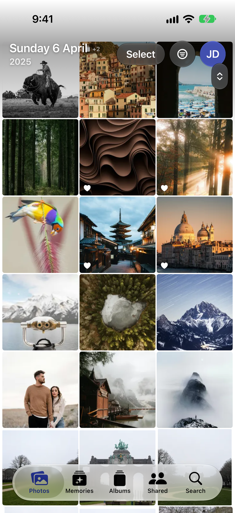 | 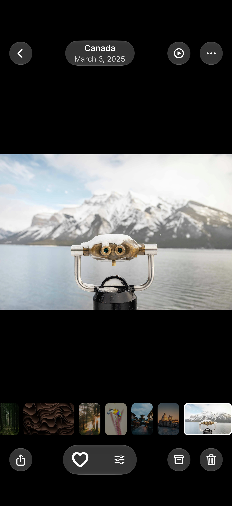 | 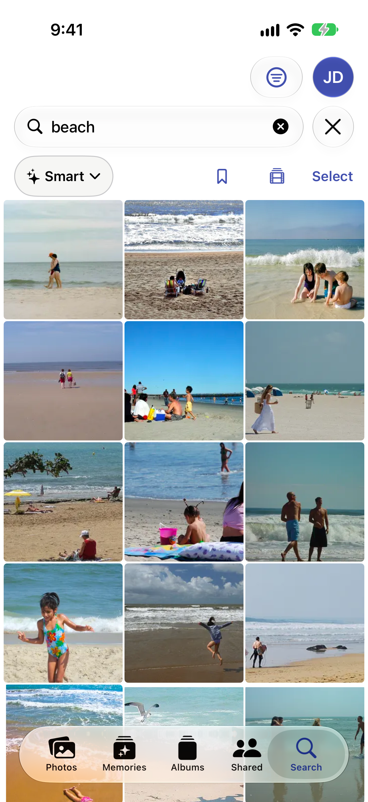 |

| People | Map | Memories |
|:-:|:-:|:-:|
| 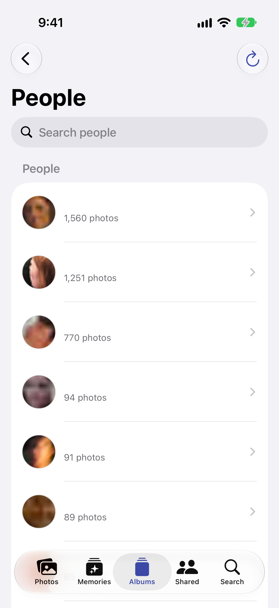 | 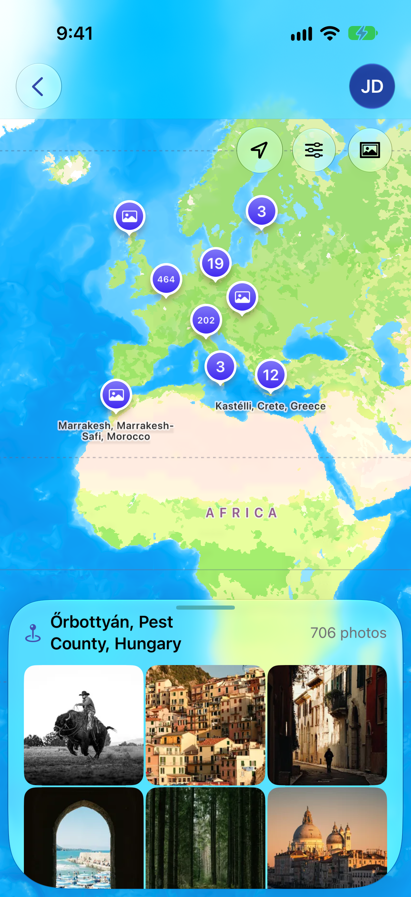 | 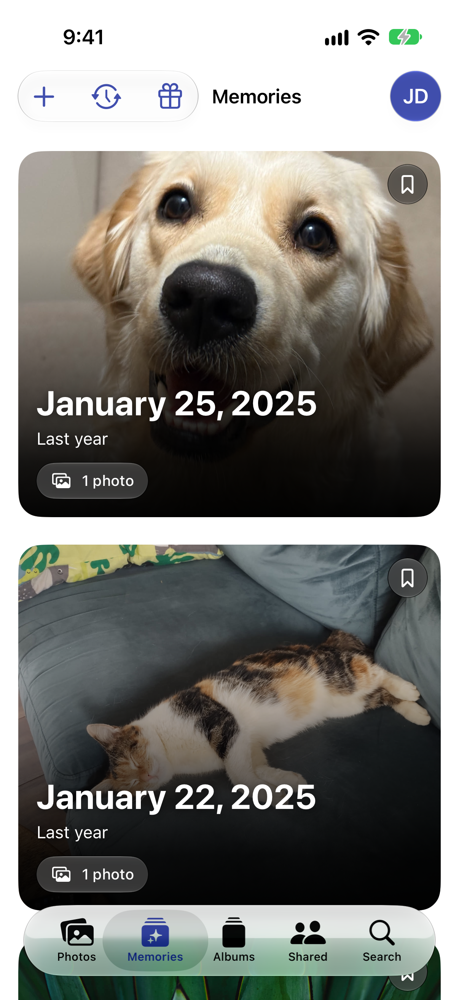 |

## Make something to share

Swimmich turns your photos into things worth posting, in a tap, on your phone. Everything is made on your iPhone from your own server: nothing is uploaded anywhere else.

### Road Trip

Pick an album from a trip: Swimmich finds the stops, draws the route on a satellite map and drives a little car from one to the next, with the best photos of each place. Save it as a vertical video.

### Reel

Search for anything, "beach", "snow", "dog", and get every match as a reel cut on the beat, with a title card, the year and the place on each photo. Works on any album or selection too.

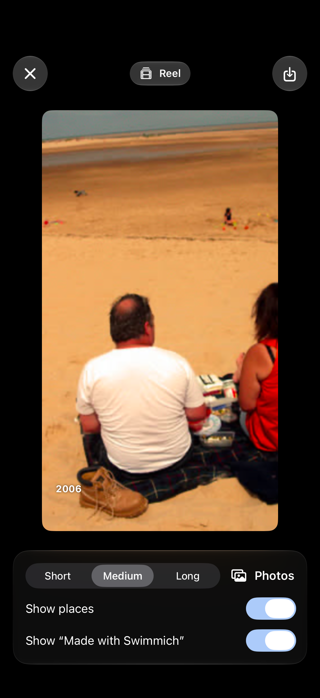

### Growing Up

Choose a person: Swimmich finds their face over the years and lines it up eye to eye, so a decade plays in seconds. Add their birthday and their age shows under each face.

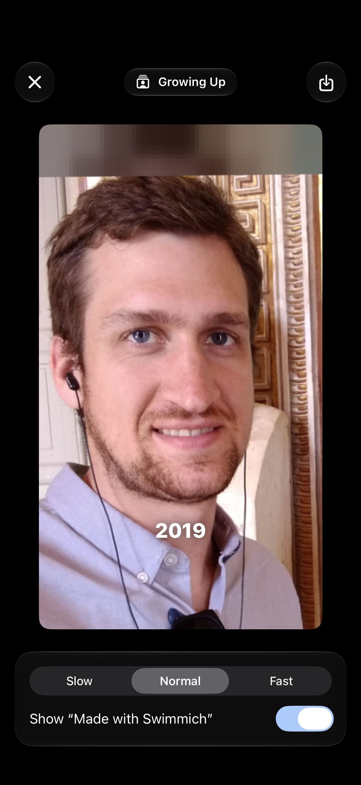

### Then & Now

The places you came back to, years apart. Drag across the picture to sweep from one year to the other, pick the photos you want, save the pair as an image or a video.

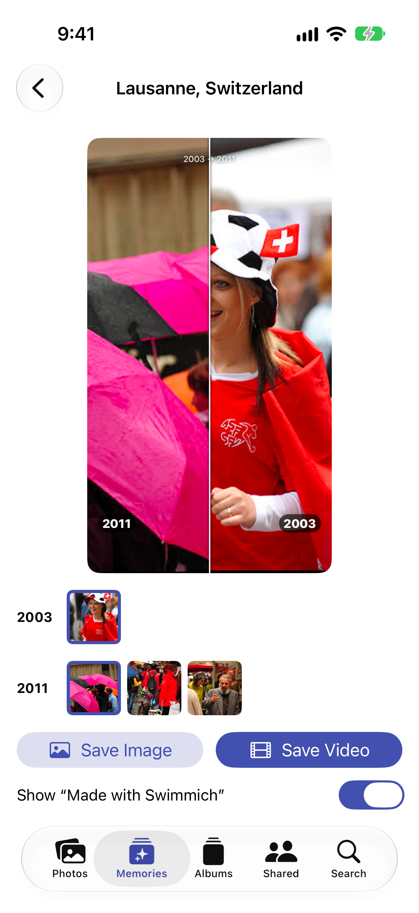

### Color Mosaic, Photo Dump and Everywhere I’ve been

| Color Mosaic | Photo Dump | Everywhere I’ve been |
|:-:|:-:|:-:|
| 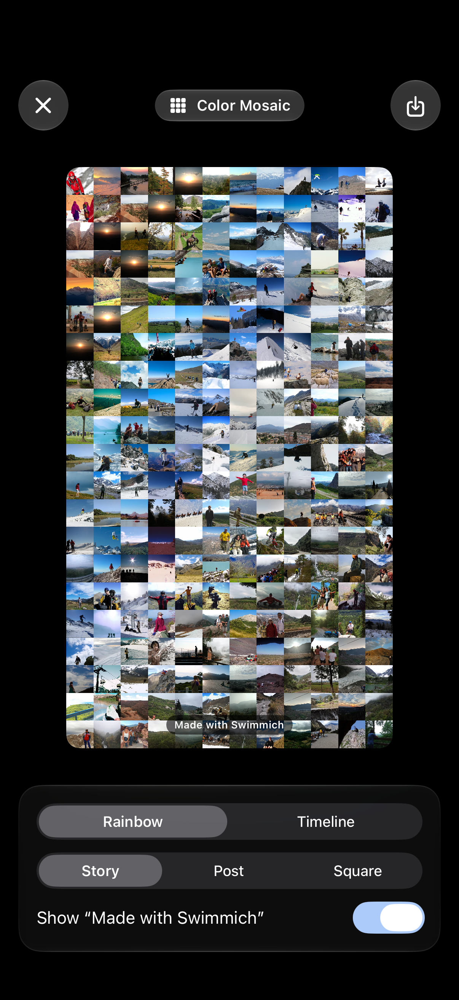 | 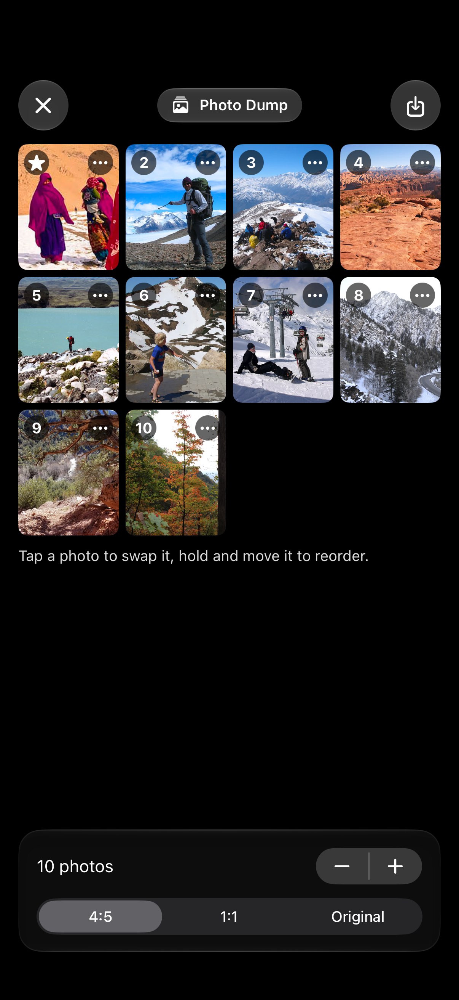 | 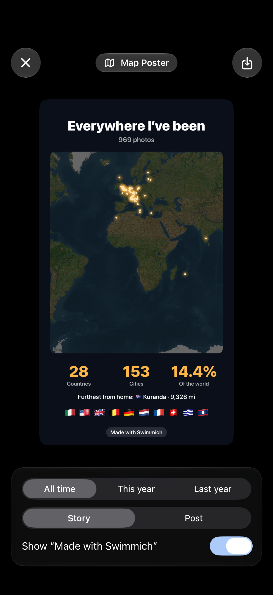 |
| An album as one picture, sorted by color | The best ten, picked for you, ready to post | Every place you photographed, on one poster |

### Wrapped

Your year in photos, as a story: your busiest month, your people, your places, your year in colors and your best shots. Share it as images or as one video.

| | | |
|:-:|:-:|:-:|
| 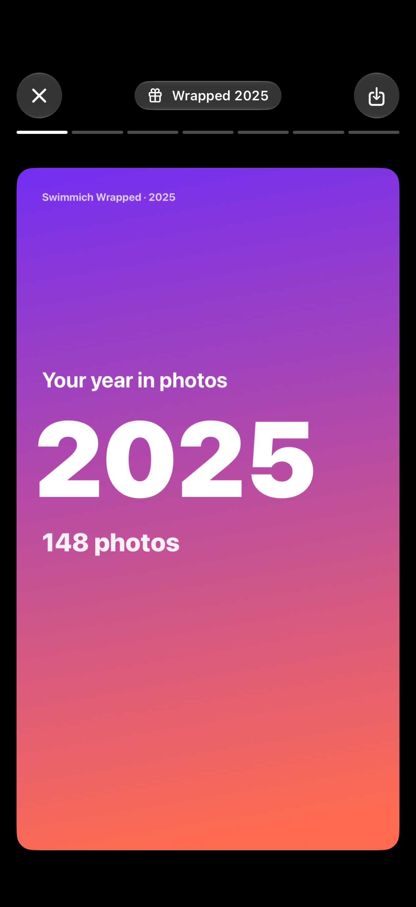 | 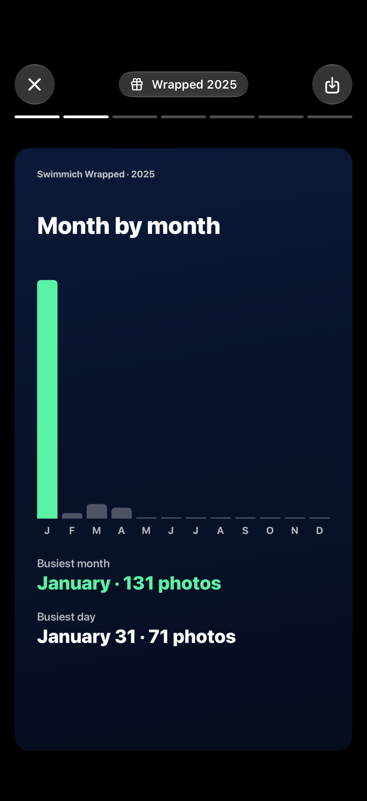 | 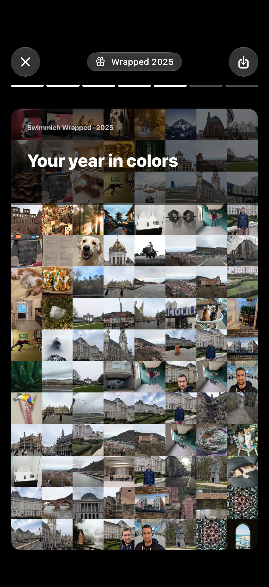 |

## Backup that keeps up

- **Automatic, in the background.** New photos go to your server on their own; the progress shows in the Dynamic Island and on the Lock Screen.
- **Built for real libraries.** Tens of thousands of photos, long 4K videos and photos still in iCloud are all backed up, without running out of memory.
- **Nothing twice.** Photos your server already has are skipped, and the ones already sent are remembered.
- **One tap, anywhere.** "Back up now" from a Home Screen widget, Siri or Shortcuts.

## And everything else

Offline copies of your favourite photos, shared links with a password and an expiry date, a locked folder behind Face ID, partner sharing, a photo editor, duplicates and trash, widgets, casting to a TV, a local and an external server address, and the app in English, French, German, Spanish and Italian.

## Get Swimmich

You need an iPhone on iOS 26 and an [Immich](https://github.com/immich-app/immich) server you can reach. Swimmich is free and its code is on GitHub; for now, build it from source with Xcode: see the [technical documentation](docs/TECHNICAL.md#quick-start).

## Contributing

Ideas, bug reports and pull requests are welcome. How the app is built, tested and released, and how to work on it: [technical documentation](docs/TECHNICAL.md).

## Credits

Swimmich is an independent app, not affiliated with the Immich project. The screenshots and the video show the public demo library of Immich.
