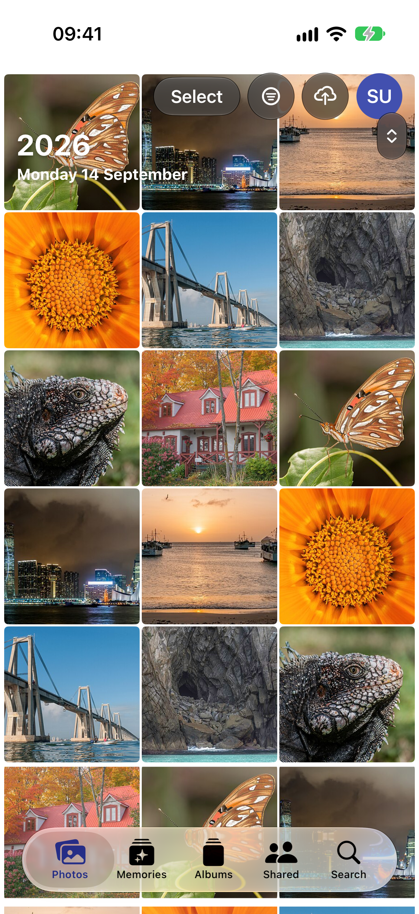
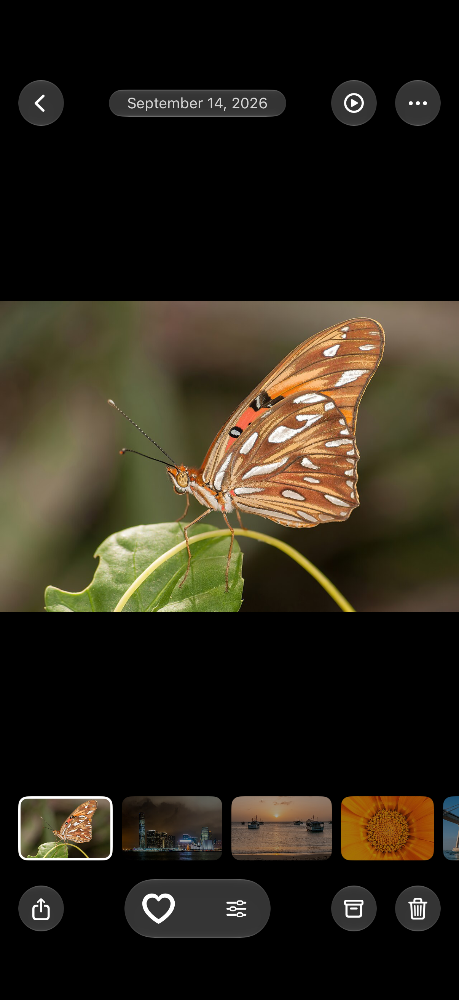
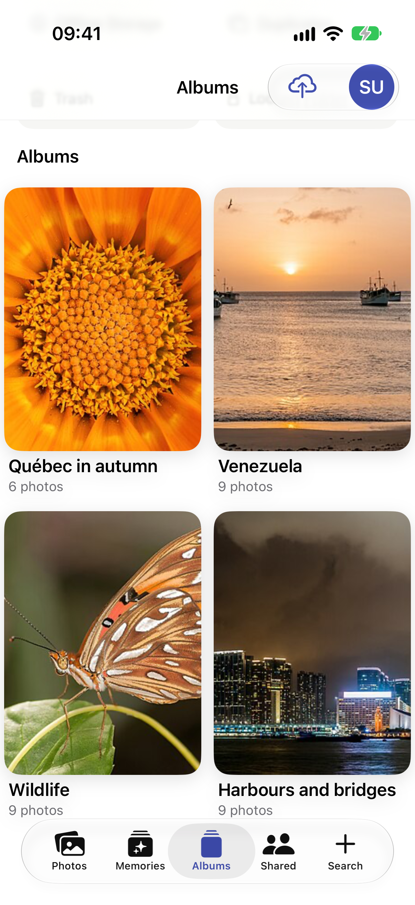
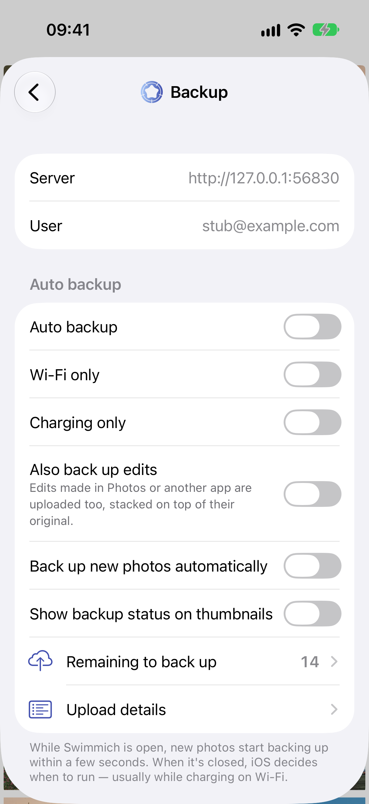
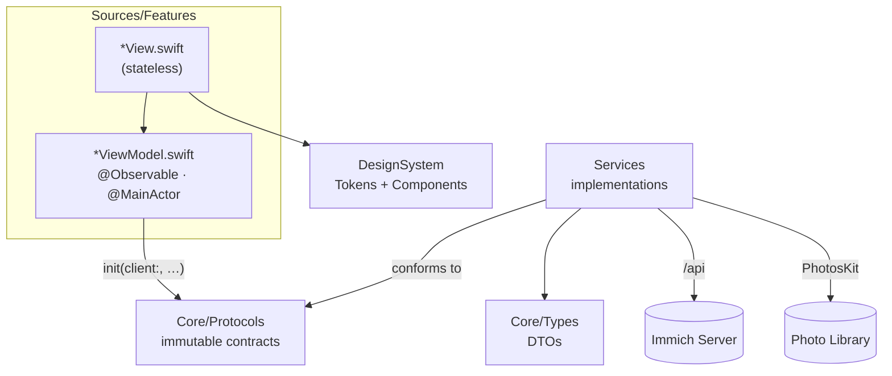

# Swimmich

> **Swimmich** is a **native** iOS (SwiftUI) client for [Immich](https://github.com/immich-app/immich), the self-hosted photo and video platform. Designed for **iOS 26** and its Liquid Glass visual language — this is not a port of the upstream Flutter client.

Swimmich uses the same server API (`/api`) as the official Immich client, with the same ambition of feature parity, but rewritten for a 100% Apple experience: SwiftUI, deep system integrations (Live Activities, Dynamic Island, widgets, App Intents, background tasks), and a backup engine built for real photo libraries (disk streaming, bounded RAM). The app is called Swimmich on the Home Screen; the Xcode project, scheme and targets keep the name `ImmichSwiftUI`.

---

## Table of Contents

- [Why a native app?](#why-a-native-app)
- [Features](#features)
- [Screenshots](#screenshots)
- [Architecture](#architecture)
- [How the app works](#how-the-app-works)
- [Quick Start](#quick-start)
- [Tests](#tests)
- [Release (App Store)](#release-app-store)
- [Contributing](#contributing)

---

## Why a native app?

1. **Native experience.** The upstream client is built with Flutter: excellent cross-platform parity, but no iOS visual language. Swimmich follows the HIG and iOS 26's Liquid Glass, using `NavigationStack`, native tab bars, and sheets.
2. **System integrations.** A Live Activity displays backup progress in the Dynamic Island and on the lock screen; BGTaskScheduler maintains a chain of background backups; an App Intent exposes "Back up now" to Siri/Shortcuts; a home screen widget triggers a backup with one tap.
3. **Performance against real photo libraries.** Backup is fully streamed disk→network: SHA-1 computed by streaming the exported file in 64 KiB chunks, multipart written to disk, uploaded from a file. RAM stays bounded regardless of asset size — large iCloud videos don't crash the app.
4. **Sovereignty.** Self-hosted, no intermediate cloud: the app talks to your Immich server, to your SSO provider if you sign in with one, and to Apple services (MapKit maps, reverse geocoding).

Feature parity with the Flutter client is tracked in [`docs/mobile-features-vs-flutter.md`](docs/mobile-features-vs-flutter.md).

## Features

Every folder of `Sources/Features/` is listed once, in the row of its domain.

| Domain | Content | Code |
|---|---|---|
| **Timeline** | photos grouped by day, grid zoom, date scrubber, multi-selection with batch actions, "Recently Taken" and "Recently Added" lists | `Sources/Features/Timeline/`, `Sources/Features/Recent/` |
| **Viewer** | full-screen pager, zoom, filmstrip, video, slideshow, info panel, detected-text overlay, faces, stacks, date and location adjustment, tags; "Try Again" on a photo that fails to load and on the details panel; haptic on favorite and delete (follows the Haptic Feedback setting); the screen stays on while the slideshow is displayed; a video whose offline copy cannot be read plays from the server's transcoded stream | `Sources/Features/PhotoViewer/`, `Sources/Features/AssetDetail/` |
| **Casting** | Cast sheet and AirPlay route picker | `Sources/Features/Cast/` |
| **Search** | semantic (CLIP) and text search, filters (people, tags, "not in album", favourites, archive, rating, camera, dates), map, saved and recent searches, multi-selection of results | `Sources/Features/Search/` |
| **Albums** | create, edit, share, activity feed, and the Library section that leads to the collections below | `Sources/Features/Albums/` |
| **People and tags** | face management with birthdays, hierarchical tags | `Sources/Features/People/`, `Sources/Features/Tags/` |
| **Folders and stacks** | server folder view, photo stacks | `Sources/Features/Folders/`, `Sources/Features/Stacks/` |
| **Duplicates and trash** | duplicate review, trash with restore | `Sources/Features/Duplicates/`, `Sources/Features/Trash/` |
| **Locked folder** | private folder behind a 6-digit PIN checked by the server; Face ID can fill that PIN in | `Sources/Features/LockedFolder/` |
| **Partners** | partner sharing: invitations and the partner's library | `Sources/Features/Partners/` |
| **Shared links** | create, password, expiration, **public viewer** (open a received link, unlock it, browse it, guest upload) | `Sources/Features/SharedLinks/` |
| **Memories** | "On this day", moments viewer | `Sources/Features/Memories/` |
| **Offline** | download originals to a durable cache, browse them with the server unreachable, storage budget and eviction, download progress panel | `Sources/Features/Offline/`, `Sources/Features/DownloadPanel/`, `Sources/Services/OfflineAssetStore.swift` |
| **Photo editor** | crop, rotate, mirror, saved as the photo's edit list on servers that support it, as a copy otherwise | `Sources/Features/Editor/` |
| **RoadTrip** | reader and export of a travel film (opening, slideshow, map route) generated from an album | `Sources/Features/RoadTrip/` |
| **Backup** | streaming, server deduplication, Live Activity, background chain, resume, upload detail, "Remaining to back up", on-device library, sync status, free up space | `Sources/Features/Upload/`, `Sources/Features/UploadDetail/`, `Sources/Features/BackupRemainder/`, `Sources/Features/LocalLibrary/`, `Sources/Features/SyncStatus/`, `Sources/Features/FreeUpSpace/`, `Sources/Services/BackupEngine.swift` |
| **Sign-in and app lock** | onboarding, password and SSO sign-in, app lock (Face ID, with the device passcode as fallback) | `Sources/Features/Auth/` |
| **Account and security** | profile and storage indicator ("Me" hub), password change, device sessions, API keys, server admin panel | `Sources/Features/Profile/`, `Sources/Features/Security/`, `Sources/Features/UserApiKeys/`, `Sources/Features/Admin/` |
| **Network and trust** | local and external server addresses, custom HTTP headers (proxy), client certificate (mutual TLS) | `Sources/Features/NetworkSettings/`, `Sources/Features/CustomHeaders/`, `Sources/Features/ClientCertificate/` |
| **Preferences and language** | theme, haptics, share quality, English source plus French, German, Spanish and Italian (follows the device, pinnable in the app, locale-aware dates), notification settings, read-only mode | `Sources/Features/Settings/`, `Sources/Features/Notifications/`, `Sources/Features/ReadOnly/`, `Resources/Localizable.xcstrings` |
| **Diagnostics and information** | application log, media statistics, asset troubleshooting, "What's New", about and licences | `Sources/Features/AppUtilities/`, `Sources/Features/WhatsNew/`, `Sources/Features/About/` |

Extensions: home screen widgets and the backup Live Activity (`ImmichWidgets/`), the share extension (`ImmichShareExtension/`), the App Intent `BackupNowAppIntent` (Siri and Shortcuts).

## Screenshots

Taken on an iPhone 17 simulator against a local stub that serves CC0 sample photos (`UITests/stubs/fixtures/readme/`): no personal photo, server address or account. The simulator's photo library receives the same CC0 photos, and the Backup screen is taken at rest, with Photos access granted and no thumbnail.

| Photos | Viewer | Albums |
|:-:|:-:|:-:|
|  |  |  |

| Search | Backup |
|:-:|:-:|
|  |  |

To regenerate them, on a Mac with Xcode (iOS 26 simulator), XcodeGen and python3:

```bash
Scripts/screenshots.sh
```

The script creates a throwaway simulator, starts `UITests/stubs/immich_stub_readme_screenshots.py` on a free port and checks that this port answers that stub and no other server, adds the CC0 photos to the simulator's photo library, installs the app and grants it Photos access with `simctl privacy`, runs the scenario `ReadmeScreenshotsUITests` and rewrites the five files of `docs/screenshots/`. Commit the result. When a push lacks one of the five files, the CI job `README screenshots` takes them on the runner and publishes them on the branch `ci/readme-screenshots`; commit them under `docs/screenshots/`.

## Architecture

Strict MVVM in 4 layers. Protocols in `Sources/Core/Protocols/` are **immutable** and the main injection point; a few process-wide stores are injected as they are; everything else is implementation or presentation.

| Layer | Role | Content |
|---|---|---|
| `Sources/Core/Types/` | API DTOs | `SearchDTOs.swift`, `APIError.swift`, `DTOs+SharedLink.swift`, … |
| `Sources/Core/Protocols/` | Contracts (main injection point) | `ImmichClient`, `PhotoLibraryService`, `BackupAssetSource`, `BackupLedgerStoring`, `BackupEditLedgerStoring`, `KeychainStore`, `TrustedServerStore`, `AppLockService`, `VideoPlaybackEngine`, `IdleTimerControlling` |
| `Sources/Services/` | Implementations | `ImmichAPIClient`, `PhotoLibraryServiceImpl`, `BackupEngine`, `BackupLedger`, `BackupEditLedger`, `ImageCache`, `AuthenticatedAsyncImage`, `RealtimeService` (Socket.IO), `KeychainStoreImpl`, … |
| `Sources/Features/<Feature>/` | Per-feature MVVM | `<Feature>ViewModel.swift` (`@Observable`, `@MainActor`) + `<Feature>View.swift` (stateless) |

Composition points:

- **`Sources/DependencyContainer.swift`** — composition root: singleton `@MainActor`, `make*ViewModel()` methods that inject what each view model needs: mostly a protocol via `init(client:)`, sometimes a process-wide store (`AppLogStore`, `WhatsNewStore`) or the view model of the screen that opens it (Backup remainder and upload details take the `UploadViewModel`, download info takes the `OfflineDownloadViewModel`).
- **`Sources/RootView.swift`** — auth-gated router: onboarding → `AuthenticatedRoot` (TabView). Account switch destroys the full subtree (`.id(activeAccountID)`), no residual state.
- **`Sources/DesignSystem/`** — `Tokens/` (`Color.immich*`, `bgPrimary`/`bgSecondary`, spacing, motion, fonts) + `Components/` (app bar, buttons, badges, skeletons, floating controls: `pvFloating(.circle|.pill|.bar)` over photos, `pvGlass(…)` — the system's adaptive glass — over the map). Colors come from these tokens; some feature views still use literal SwiftUI colors (`Color.white`, `Color.red`…), to migrate, not to copy.
- **`Sources/ImmichSharedKit/`** — shared framework app ⇄ extensions: ActivityKit attributes and views for the Live Activity, the widget session, `MultipartBody` (upload bodies written to disk).
- **`ImmichWidgets/`** — widget extension (home screen widgets + Live Activity). **`ImmichShareExtension/`** — share extension.



## How the app works

### Authentication

1. **Onboarding:** server URL (typed or QR code scan) → ping `/api/server/ping` + server configuration. A non-blocking notice warns when the server's version is below 2.0.0 or from 4.0.0.
2. **Login:** the sign-in step shows only the modes the server accepts: `GET /api/public/config` on a server that serves it (v3.2+), the deprecated `GET /api/server/features` otherwise. Password (`/api/auth/login`), SSO — OAuth2/OIDC through `ASWebAuthenticationSession` — or both; a server that accepts neither says so. A password sign-in of a non-administrator whose server sets `shouldChangePassword` goes through the change-password step before the home screen; until the change succeeds the token stays in memory only.
3. **Token storage and launch:** the token is stored in the Keychain. A launch with a stored session opens the Photos tab at once; `restoreSession()` validates the token behind it (a 401 returns to the sign-in step, "session expired").
4. **App Lock (Face ID or passcode):** locks when the app goes to background, with the overlay `AppLockCoverView`.

### Data and Images

- **`ImmichAPIClient`**: all URLs pass through `ImmichAPI`; token in header; thread-safe client; typed errors `APIError`.
- **Images:** `AuthenticatedAsyncImage`, 4-level pipeline (offline copy when present, memory cache `ImageCache`, disk cache, network with auth headers).
- **Real-time:** `RealtimeService` (Socket.IO, injectable `RealtimeTransport`) for server events. Each debounced burst posts `.immichAssetsChanged` with its event names (`RealtimeBatch`): the Photos, Albums, People, Memories and Offline lists reload, and the viewer re-reads its photo when an edit is regenerated.
- **Custom HTTP headers (proxy):** name/value pairs declared per server from the server step of onboarding or Me › Advanced. They live in the shared-group Keychain (`KeychainCustomHeadersStore`), never in the logs, and every request to that server carries them (`CustomHeadersRegistry`), widgets and share extension included. A redirect to another host drops them (`ServerRedirectPolicy`). A `401` carrying `WWW-Authenticate` is the proxy refusing (`APIError.proxyRejected`): the session is kept.
- **Client certificate (TLS mutual authentication):** a PKCS#12 file imported per server from the server step of onboarding or Me › Advanced. The identity lives in the shared-group Keychain (`KeychainClientIdentityStore`); `ClientCertificateResponder` answers the TLS challenge of every connection of the app, and `WidgetTrustDelegate` those of the widgets and the share extension. A server asking for a certificate nobody can present gives `APIError.clientCertificateRequired`.
- **Local and external server address:** Me › Advanced › Network declares, per account, a local address, an external address and an automatic switch, off by default (`ServerEndpointSwitch`). With the switch on, the local address is used only when the server answers `GET /api/server/ping` and `GET /api/server/version` with the same version as the external address, within 2 s; otherwise the external one. The account keeps one identity (`ServerAddressBook`); the widgets apply the same rule (`WidgetEndpointResolver`).

### Auto-Backup — the crown jewel

`BackupEngine` is a phase machine: `checking → uploading → done / cancelled`.

1. **Scan** the photo library (PhotosKit): the whole library by default, or only the albums you select or exclude (smart albums included: Screenshots, Selfies, Bursts, Videos).
2. **Pass 1 — hash:** SHA-1 streamed from the exported file in 64 KiB chunks; never the entire asset in RAM.
3. **Server deduplication:** `/api/assets/bulk-upload-check`.
4. **Pass 2 — upload:** each accepted asset is sent from the file exported for pass 1 (no second export or iCloud download): multipart body written to disk, then uploaded from the file. Bounded RAM, large videos are backed up instead of skipped.
5. **`BackupLedger`:** already-backed-up assets are not re-exported — avoids re-downloading the entire "Optimize Storage" iCloud library on every run.
6. **iCloud assets:** dedicated states (downloading, retry) with status messages in the UI.
7. **Also back up edits (opt-in, off by default):** an asset edited in place in Photos has its edited rendering exported, uploaded under the same `deviceAssetId`, then stacked on top of its original with `POST /api/stacks`. The edits already sent are recorded by `BackupEditLedger`, beside the original ledger.

Reliable progress: total fixed after filtering; the bar is `(processed + ½ × staged) / total`, where processed = uploaded, already on the server, failed or deferred (iCloud original not local yet), and staged = exported and hashed, waiting for its upload.

System surfaces:

- **Live Activity** (`LiveActivityBackupService`) — progress in the Dynamic Island and lock screen.
- **BGTaskScheduler** — self-sustaining chain of background backups (`app.immich.background-backup`).
- **App Intent** — "Back up now" from Siri/Shortcuts; the home screen widget triggers it via the deep link `app.immich://backup`, which starts a manual backup pass on the Photos tab.

### Navigation

`AuthenticatedRoot`: TabView (Photos, Memories, Albums, Shared) + native iOS 26 Search tab (`role: .search`). The Albums tab opens with a **Library** section: the content collections (Recently Taken, Recently Added, People, Tags, Folders, Stacks, Partners, On this device, Offline Storage, Duplicates, Trash, Locked Folder), one touch each, pushed onto the tab's own `NavigationStack`. Favorites and Archive are the filter button of the Photos tab; places are Explore, the Search tab's home until a search runs (the map opens from the map preview at its head; a search of filters alone starts from the Filters button, and Back or the field's ✕ returns to Explore). Profile ("Me") is presented as a sheet from the avatar on each tab — the avatar also carries the backup's progress ring, and Sync Status is the hub's first row — and keeps the account, settings and tools only.

## Quick Start

### Prerequisites

- Xcode with iOS 26 SDK
- [XcodeGen](https://github.com/yonaskolb/XcodeGen) — `project.yml` is the project source of truth; `ImmichSwiftUI.xcodeproj` is **generated**.

```bash
xcodegen generate
open ImmichSwiftUI.xcodeproj
# select a simulator (iPhone 17, iOS 26), then ⌘R
```

On first launch: URL of your Immich instance (or QR code scan), then login. Any recent Immich server works.

## Tests

```bash
xcodebuild test -project ImmichSwiftUI.xcodeproj -scheme ImmichSwiftUI -destination 'platform=iOS Simulator,name=iPhone 17' -only-testing:ImmichSwiftUITests
python3 -m unittest discover -s Scripts -p 'test_*.py'
```

- Unit tests live in `Tests/`: view models are tested with a `MockImmichClient` injected via `init(client:)`, or with the dependency they take (`AdvancedSettingsViewModel` takes a log and an image cache). End-to-end UI scenarios live in `UITests/Scenarios/`, each with its Python stub under `UITests/stubs/`; `Scripts/ci.sh` runs the ones listed in `Scripts/ci-ui-scenarios.txt`.
- The Python tests of `Scripts/` cover the CI, the release chain, the string catalog audit and these READMEs.
- **Trap:** the test target sources the entire `Tests/` folder — a new `Tests/*.swift` file is only compiled after `xcodegen generate`. Without regeneration, tests pass "green" by omission.

### CI and signed IPA

```bash
Scripts/ci.sh            # what CI runs: xcodegen generate, build both test bundles, unit tests, listed UI scenarios
Scripts/ipa.sh [version] # Release archive + IPA signed Apple Distribution in build/ipa/Swimmich.ipa
```

- **CI** (`.github/workflows/ci.yml`) runs `Scripts/ci.sh` on every push, any branch, on a self-hosted Mac runner (labels `self-hosted, macOS, ARM64, xcode`). It keeps DerivedData in `~/Library/Caches/swimmich-ci`, so a run only rebuilds what changed. The job `Unit tests (iOS simulator)` is the check `main` requires. There is no `pull_request` trigger: a fork's pull request never runs code on that Mac.
- **Search captures**: the job `Search captures` runs `Scripts/ci-search-captures.sh`. That script takes the series named by `Scripts/search-captures-series` (`before` or `after`), that is 7 PNGs of the Search tab, each with its measure, then pushes them with a SOURCE.txt file to the branch `ci/search-captures-<series>`. Only the Git branch that created a series can replace it.
- **Simulator pool:** the unit tests and the UI scenarios listed in `Scripts/ci-ui-scenarios.txt` run side by side on a pool of simulators of their own (`SWIMMICH_CI_UI_WORKERS`, 3 by default: `swimmich-ci-ui-1`, `-ui-2`, `-ui-3`, created on first use), one job per simulator at a time. A simulator is reset between jobs (app uninstalled, keychain emptied, privacy grants revoked, text size back to L), not erased: an erased simulator spends its first minutes rebuilding wallpapers, widgets and Photos, and erasing one per line kept the whole Mac busy. With [simslim](https://github.com/MobAI-App/simslim) installed (`brew install mobai-app/tap/simslim`), each simulator of the pool is slimmed with `Scripts/simslim-ci.json` (background daemons the tests do not use turned off) before it boots; without it the pool runs stock. A reset keeps Photos and the Face ID enrolment; a line that needs a freshly erased device declares `--erase`. Each line gets its own stub from `UITests/stubs/` on its worker's port (8421, 8422, …), plus the device prerequisites it declares (`--content-size`, `--media`). One test per line, the longest first: the run lasts at least as long as its longest line, so a UI test over 3 minutes gets a CI warning and is cut in several. Each line of the list carries a tier (`Scripts/ci_ui_select.py`). Every push runs the gate (`SWIMMICH_CI_UI_SCOPE=gate`, under 5 minutes, build included: `Scripts/ci.sh` prints its timings and warns over `SWIMMICH_CI_GATE_BUDGET`): the lines the push can have broken first (a new or edited line, a line whose test function or stub changed; a changed helper selects its class, comments alone select nothing), then the `--smoke` lines, one line per simulator the unit tests leave free so that no scenario waits behind another (a changed line that finds no room gets a warning and is left to the night's suite). Every night `main` runs the core suite (`core`, about 25 minutes): the smoke lines, each feature's journeys and the scenarios that are the only proof of a criterion. The `--release` lines, second proofs of criteria the unit tests already prove, run with all the others (`all`, about 50 minutes) on Sunday night and on a `v*` tag before its IPA; `all` is also what `Scripts/ci.sh` runs on a developer's Mac. One suite runs at a time on the Mac. The CI checks two budgets (5 smoke lines, 40 lines in the night's suite): a detailed criterion goes to a unit test, a whole screen to a hosted test (`Tests/HostedScreen.swift`), not to a new scenario. A scenario that fails or skips itself fails the CI. The other scenarios are compiled, not run.
- **Signed IPA**: on `main`, once the tests pass, the `Signed IPA` job runs `Scripts/ipa.sh` and keeps `Swimmich.ipa` as a workflow artifact for 14 days. Signing is automatic, through the Apple ID signed in to Xcode on the runner's Mac: if that account signs out or its session expires, the job fails. An App Store Connect API key (`ASC_KEY_ID`, `ASC_ISSUER_ID`, `ASC_KEY_PATH`) replaces it when set. Nothing is sent to App Store Connect from `main`; on a `v<version>` tag, the job `App Store upload` archives, signs and sends the build instead (see [Release (App Store)](#release-app-store)). `Scripts/ipa.sh --upload` stays the manual upload, from a developer's Mac signed in with an Apple ID. Every IPA that `Scripts/ipa.sh` produces first passes a packaging check: a single `ImmichSharedKit.framework`, embedded by the app only, and no `Frameworks/` folder in the two extensions.
- **Runner trap:** the runner's LaunchAgent must not set `SessionCreate`. `svc.sh install` sets it, and then codesign cannot reach the login keychain (`errSecInternalComponent`).

### String catalog audit

```bash
python3 Scripts/i18n-audit.py
```

`Scripts/i18n-audit.py` guards `Resources/Localizable.xcstrings` against the four ways it drifts: a catalog key no build target claims (**dead**), a key the code claims that the catalog is missing (**missing**), a claimed key with no `fr`, `de`, `es` or `it` translation (**untranslated**), and a key that formats an integer counter (`%lld`, `%d`, `%2$lld`…) without plural forms (**plural**, rule R4). It renders its verdict from a real extraction — a virgin DerivedData build with `SWIFT_EMIT_LOC_STRINGS=YES` (~40 s, its own DerivedData, `--derived-data <path>` to move it) — and never edits the catalog or a source: it names the offending keys, the fix stays manual. Exit codes: `0` all four sets empty, `1` at least one offending key (listed by section), `2` tooling — no valid `DEVELOPER_DIR`, build failure, incomplete extraction, unreadable catalog. A `.swift` compiled without its `.stringsdata` is an exit `2`, never a clean verdict.

Rule R4 reads the catalog alone, no build. A counted key needs `one` and `other` forms, non-empty, in `en`, `fr`, `de`, `es` and `it` (`variations.plural`), or, when the key counts several things (`%lld photos · %lld videos`), one plural substitution per counter (`%#@photos@ · %#@videos@`, `argNum` = the counter's position). A closed list of keys is exempt — "N of M" reports, percentages, and eight bare numbers (`PLURAL_EXCEPTIONS`) — and an exception that is none of those three is itself refused. `python3 Scripts/i18n-audit.py --plurals-only` runs R4 alone (prints `plural violations: <n>`, exit `0`/`1`, `2` for an unreadable catalog) and `--catalog <path>` audits another catalog. `Scripts/test_i18n_audit.py` tests the rule (`python3 -m unittest discover -s Scripts -p 'test_*.py'`). `Scripts/ci.sh` runs those tests first, then the full audit right after `xcodegen`; its verdict is applied at the end of the script, and each offending line becomes a public `::error` annotation.

## Release (App Store)

Pushing a tag `v<version>` makes CI archive Swimmich in Release, sign it for the App Store and send the build to App Store Connect (TestFlight), with no manual step on the CI Mac. Every sensitive element comes from the secrets of a GitHub Environment: nothing sensitive is stored in the repository.

### Prerequisites

Done once, by a human:

- **App record.** The app exists on App Store Connect for the bundle `fr.millianlmx.immich-ios` (the extensions `fr.millianlmx.immich-ios.widgets` and `fr.millianlmx.immich-ios.share-extension` need no record of their own).
- **Certificate.** An Apple Distribution certificate of the team `2MJF39L8VY`, with its private key, exported as a `.p12`.
- **Profiles.** Three provisioning profiles of type App Store Connect, one per bundle (`fr.millianlmx.immich-ios`, `.widgets`, `.share-extension`), each including that certificate.
- **API key.** An App Store Connect API key (team key, App Manager role): it only serves the upload.
- **Environment.** A GitHub Environment named `app-store` (Settings › Environments › New environment `app-store` › Deployment branches and tags › Selected branches and tags › Add deployment branch or tag rule › type Tag, pattern `v*`). Create the 8 secrets below in that Environment, not as repository secrets: a repository secret is readable by every branch that edits `.github/workflows/ci.yml`, and this workflow runs on every push, on a shared Mac. Only the job `App Store upload` declares the Environment, so no other job receives these secrets.
- **Tag ruleset (recommended).** Settings › Rules › Rulesets › New tag ruleset, target `v*`, rules Restrict creations, Restrict updates and Restrict deletions, bypass list limited to repository admins: only maintainers can then create a `v*` tag, hence trigger an upload.
- **Renewal.** The certificate and the profiles expire after one year. Replace them by updating the secrets; a tag pushed with an expired profile fails and the annotation names the secret.

### Secrets

Exactly the secrets that `.github/workflows/ci.yml` reads, in the Environment `app-store`. To put a file in a secret, encode it and copy the result: `base64 -i dist.p12 | pbcopy`.

| Secret | Content | Format | Where to get it | Apple role |
| --- | --- | --- | --- | --- |
| `APPLE_DISTRIBUTION_P12_BASE64` | Apple Distribution certificate with its private key | `.p12` file in base64 | Keychain Access › export the identity as `.p12`; certificate from Certificates, Identifiers & Profiles › Certificates | Account Holder or Admin, or App Manager with access to certificates |
| `APPLE_DISTRIBUTION_P12_PASSWORD` | Password chosen when exporting the `.p12` | Plain text | Chosen at the export | None |
| `PROFILE_APP_BASE64` | App Store Connect profile of `fr.millianlmx.immich-ios`, including the certificate above | `.mobileprovision` file in base64 (`base64 -i <profile>.mobileprovision`) | Certificates, Identifiers & Profiles › Profiles | Same roles as the certificate |
| `PROFILE_WIDGETS_BASE64` | App Store Connect profile of `fr.millianlmx.immich-ios.widgets` | `.mobileprovision` file in base64 | Certificates, Identifiers & Profiles › Profiles | Same roles as the certificate |
| `PROFILE_SHARE_EXTENSION_BASE64` | App Store Connect profile of `fr.millianlmx.immich-ios.share-extension` | `.mobileprovision` file in base64 | Certificates, Identifiers & Profiles › Profiles | Same roles as the certificate |
| `ASC_KEY_ID` | Key ID of the API key | 10 characters, letters and digits | Users and Access › Integrations › App Store Connect API › Team Keys | App Manager (role of the key) |
| `ASC_ISSUER_ID` | Issuer ID of the API keys | UUID | Same page, above the list of keys | App Manager (role of the key) |
| `ASC_KEY_P8_BASE64` | The key file `AuthKey_<ID>.p8` | `.p8` file in base64, downloadable once | Same page, when the key is created | App Manager (role of the key) |

### Publishing a release

```bash
git tag v1.2.3 && git push origin v1.2.3
```

- **Tag format:** `v<major>`, `v<major>.<minor>` or `v<major>.<minor>.<patch>`, numbers without a leading zero. The tag sets the marketing version; the build number is the UTC time (`YYYYMMDD.HHMM`), which only grows.
- **Checks first.** The run goes through `Unit tests (iOS simulator)`, then the release UI suite, then `App Store upload`. If a check fails, nothing is sent.
- **Missing secret.** `App Store upload` fails before archiving and names each missing or malformed secret in an annotation of the run (job logs may not be readable without admin rights).
- **Signing.** `Scripts/release.sh` signs manually, from a temporary keychain and the three profiles: no Apple ID, no certificate or profile created on the Apple side. An annotation `Signing` shows the SHA-1 of the certificate that signed the app and its two extensions, and the profile UUIDs. The keychain, the decoded secrets and the installed profiles are removed when the job ends, failure included.
- **`main`** still produces the IPA as an artifact, signed by the Apple ID signed in to Xcode on the Mac, and sends nothing.
- **IPA of the tag.** Kept as the artifact `swimmich-ipa` for 14 days.

### After the upload

- **Follow the build** in App Store Connect › your app › TestFlight; processing takes a few minutes. The run ends with an annotation `App Store Connect` once the upload is done.
- **Missing Compliance.** Until the app declares its encryption (the Info.plist key ITSAppUsesNonExemptEncryption), every build waits in Missing Compliance: answer the export compliance questionnaire in App Store Connect for every build. This is manual.
- **Still manual:** submitting the build to App Review and putting the app on sale. Nothing in the pipeline does either.

## Contributing

Development follows an **acceptance card** (AC) methodology. Backlog: [`.omp/backlog/ImmichSwiftUI-backlog.md`](.omp/backlog/ImmichSwiftUI-backlog.md).

1. **Pick a feature** from the backlog (tracking table, P0–P5 phases, missing endpoints).
2. **Read the specs:** `.omp/<feature>/<feature>.specs.md` (requirements) and `<feature>.ui.md` (UI brief: navigation, tokens, behaviors).
3. **Implement in order:** protocol (`Core/Protocols/`) → service (`Services/`) → view model + view (`Features/`) → design only through `DesignSystem/` tokens.
4. **Test** with a mocked injection, then `xcodegen generate` and the full suite.
5. **PR:** one feature = its AC cards checked, its specs updated.

Conventions to follow:

- **Strict MVVM:** immutable protocols, single injection via `DependencyContainer`, view models `@Observable @MainActor` never shared, stateless views.
- **Navigation:** `NavigationStack` everywhere for navigable screens.
- **Design:** `DesignSystem` tokens only (`Color.immich*`, `bgPrimary`/`bgSecondary`); iOS 26 Liquid Glass language.
- **Tests:** one test defends observable behavior (never implementation, default values, or mock text).
- **Project memory:** see `AGENTS.md` (mem0) — consult memory before debugging or settling conventions.

### Documentation

| Doc | Content |
|---|---|
| `docs/mobile-features-vs-flutter.md` | Upstream Flutter client reference (parity target) |
| `docs/feature-parity-plan.md` | Flutter parity plan |
| `docs/app-review-ats.txt` | App Review justification for `NSAllowsArbitraryLoads` (app, widget, Share Extension), ready to paste into App Store Connect |
| `.omp/backlog/ImmichSwiftUI-backlog.md` | Backlog: phases, AC cards, missing endpoints |
| `.omp/<feature>/` | Specs + UI briefs + acceptance cards per feature |
