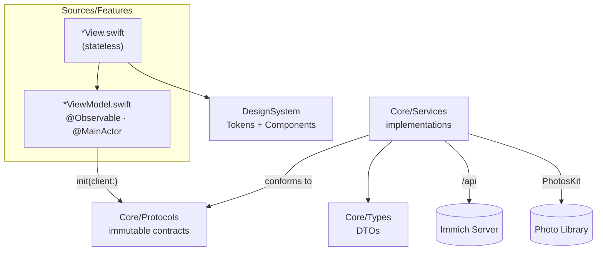

# ImmichSwiftUI

> A **native** iOS (SwiftUI) client for [Immich](https://github.com/immich-app/immich), the self-hosted photo and video platform. Designed for **iOS 26** and its Liquid Glass visual language — this is not a port of the upstream Flutter client.

ImmichSwiftUI uses the same server API (`/api`) as the official client, with the same ambition of feature parity, but rewritten for a 100% Apple experience: SwiftUI, deep system integrations (Live Activities, Dynamic Island, widgets, App Intents, background tasks), and a backup engine built for real photo libraries (disk streaming, bounded RAM).

---

## Table of Contents

- [Why a native app?](#why-a-native-app)
- [Features](#features)
- [Architecture](#architecture)
- [How the app works](#how-the-app-works)
- [Quick Start](#quick-start)
- [Tests](#tests)
- [Contributing](#contributing)

---

## Why a native app?

1. **Native experience.** The upstream client is built with Flutter: excellent cross-platform parity, but no iOS visual language. ImmichSwiftUI follows the HIG and iOS 26's Liquid Glass, using `NavigationStack`, native tab bars, and sheets.
2. **System integrations.** A Live Activity displays backup progress in the Dynamic Island and on the lock screen; BGTaskScheduler maintains a chain of background backups; an App Intent exposes "Back up now" to Siri/Shortcuts; a home screen widget triggers a backup with one tap.
3. **Performance against real photo libraries.** Backup is fully streamed disk→network: SHA-1 hashed in 1 MB blocks, multipart written to disk, uploaded via `URLSession.upload(fromFile:)`. RAM stays bounded regardless of asset size — large iCloud videos don't crash the app.
4. **Sovereignty.** Self-hosted, zero intermediate cloud: the app communicates only with your Immich server.

Feature parity with the Flutter client is tracked in [`docs/mobile-features-vs-flutter.md`](docs/mobile-features-vs-flutter.md).

## Features

| Domain | Content | Code |
|---|---|---|
| **Timeline** | daily buckets, grid zoom, thumbnails | `Sources/Features/Timeline/` |
| **Viewer** | full-screen pager, zoom, filmstrip, video, slideshow, EXIF panel, stacks, faces | `Sources/Features/PhotoViewer/` |
| **Search** | semantic (CLIP), faces, locations (map), tags, advanced filters | `Sources/Features/Search/` |
| **Albums** | CRUD, sharing, activity feed | `Sources/Features/Albums/` |
| **People, Tags, Duplicates, Trash** | face management, tags, duplicate detection, restore | `Sources/Features/People/`, `Tags/`, `Duplicates/`, `Trash/` |
| **Shared Links** | CRUD, password, expiration, **public viewer** (open a received link, unlock it, browse it, guest upload) | `Sources/Features/SharedLinks/` |
| **Memories** | "On this day", moments viewer | `Sources/Features/Memories/` |
| **Offline Download** | download originals to a durable cache, browse them with the server unreachable, storage budget + eviction | `Sources/Features/Offline/` + `Sources/Services/OfflineAssetStore.swift` |
| **Photo Editor** | crop, rotate, non-destructive editing | `Sources/Features/Editor/` |
| **RoadTrip** | reader + export of a travel film (opening → slideshow → map route) generated from an album | `Sources/Features/RoadTrip/` |
| **Auto-Backup** | streaming, server dedup, Live Activity, background, resume | `Sources/Features/Upload/` + `Sources/Services/BackupEngine.swift` |
| **Admin** | server admin panel | `Sources/Features/Admin/` |
| **Profile** | storage indicator, app lock (Face ID), language picker | `Sources/Features/Profile/` |
| **Language** | English source + French, German, Spanish, Italian; follows the device by default, pinnable in-app, locale-aware dates | `Resources/Localizable.xcstrings` + `Sources/Features/Settings/` |

Extensions: home screen widget ("Back up now" tile, `ImmichWidgets/`), backup Live Activity (Dynamic Island), App Intent `BackupNowAppIntent` (Siri/Shortcuts).

## Architecture

Strict MVVM in 4 layers. Protocols in `Core/Protocols/` are **immutable** and form the sole injection point; everything else is implementation or presentation.

| Layer | Role | Content |
|---|---|---|
| `Sources/Core/Types/` | API DTOs | `DTOs*.swift`, `SearchDTOs.swift`, `APIError.swift`, … |
| `Sources/Core/Protocols/` | Contracts (sole injection point) | `ImmichClient`, `PhotoLibraryService`, `BackupAssetSource`, `BackupLedgerStoring`, `KeychainStore`, `TrustedServerStore`, `AppLockService`, `VideoPlaybackEngine` |
| `Sources/Services/` | Implementations | `ImmichAPIClient`, `PhotoLibraryServiceImpl`, `BackupEngine`, `BackupLedger`, `MultipartBody`, `ImageCache`, `AuthenticatedAsyncImage`, `RealtimeService` (Socket.IO), `KeychainStoreImpl`, … |
| `Sources/Features/<Feature>/` | Per-feature MVVM | `<Feature>ViewModel.swift` (`@Observable`, `@MainActor`) + `<Feature>View.swift` (stateless) |

Composition points:

- **`Sources/DependencyContainer.swift`** — composition root: singleton `@MainActor`, `make*ViewModel()` methods injecting protocols via `init(client:)`. No shared view models.
- **`Sources/RootView.swift`** — auth-gated router: onboarding → `AuthenticatedRoot` (TabView). Account switch destroys the full subtree (`.id(activeAccountID)`), no residual state.
- **`Sources/DesignSystem/`** — `Tokens/` (`Color.immich*`, `bgPrimary`/`bgSecondary`, spacing, motion, fonts) + `Components/` (app bar, buttons, badges, skeletons). No hardcoded colors in views.
- **`Sources/ImmichSharedKit/`** — shared framework app ⇄ widget extension: ActivityKit attributes and views for the Live Activity.
- **`ImmichWidgets/`** — widget extension (home screen tile + Live Activity).



## How the app works

### Authentication

1. **Onboarding:** server URL (typed or QR code scan) → ping `/api/server/ping` + server configuration.
2. **Login:** email/password (`/api/auth/login`) or OAuth2/OIDC (`ASWebAuthenticationSession`, callback `app.immich:///oauth-callback`).
3. **Token storage:** stored in Keychain; on every launch, `restoreSession()` re-validates the token and rebuilds the session.
4. **App Lock (Face ID):** locks when the app goes to background, overlay `LockView`.

### Data and Images

- **`ImmichAPIClient`**: all URLs pass through `ImmichAPI.SubPath`; token in header; thread-safe client; typed errors `APIError`.
- **Images:** `AuthenticatedAsyncImage`, 4-level pipeline (offline file — served from the download cache when present and downsampled through ImageIO, actor-isolated memory cache `NSCache`, disk cache, network with auth headers).
- **Real-time:** `RealtimeService` (Socket.IO, injectable `RealtimeTransport`) for server events, connected at login and at relaunch with a stored session. Each debounced burst posts `.immichAssetsChanged` with its event names (`RealtimeBatch`) and every screen refreshes as before.
- **Custom HTTP headers (proxy):** name/value pairs declared per server (host + effective port) from the server step of onboarding ("HTTP Headers") or Me › Advanced. They live in the shared-group Keychain (`KeychainCustomHeadersStore`), never in the logs or `UserDefaults`, and every request to that server carries them — API, images, video, transfers, offline copies, editor, realtime socket (`CustomHeadersRegistry`), and widgets/share extension through `WidgetSession.customHeaders`. One rule dresses a request: `ServerRequestAuthorization` (a custom `Authorization`, e.g. proxy Basic auth, moves the session token to `x-immich-user-token`). A redirect to another host drops them (`ServerRedirectPolicy`). A `401` carrying `WWW-Authenticate` is the proxy refusing (`APIError.proxyRejected`): the session is kept.
- **Client certificate (TLS mutual authentication):** a PKCS#12 file imported per server (host + effective port) from the server step of onboarding ("Client Certificate") or Me › Advanced, then unlocked with its password (a refused import changes nothing; a PKCS#12 written by OpenSSL 3 with its default algorithms may be refused with the wrong-password status — re-export it with `-legacy`). The identity lives in the shared-group Keychain (`KeychainClientIdentityStore`: one identity plus one `host:port → SHA-256` mapping per server, `afterFirstUnlockThisDeviceOnly`), survives a sign-out and is only deleted by "Remove". `ClientCertificateResponder` answers the TLS challenge of every connection of the app — API, images, transfers, Road Trip, video (`AppTransportVideoLoader` serves AVFoundation's byte ranges on the app's session; AirPlay of a video is not available behind a client certificate and the Cast sheet says so), the realtime socket (`URLSessionSocketEngine`, a Socket.IO engine over `URLSessionWebSocketTask`) — and of the widgets and the share extension (`WidgetTrustDelegate`). A change replaces the sessions (`SessionRenewing`: new sessions, old ones invalidated) so the next handshake is a full one; widgets and the extension use a session per refresh / per share. A server asking for a certificate that nobody can present gives `APIError.clientCertificateRequired` (`MissingClientCertificate`, fed by the `TLSChallengeLog` of the delegates) and a message that names the missing certificate. The "Trust this server?" rule is unchanged, and the web SSO page does not present the certificate.

### Auto-Backup — the crown jewel

`BackupEngine` is a phase machine: `checking → uploading → done / cancelled`.

1. **Scan** the photo library (PhotosKit) with filters (screenshots, Camera Roll, WhatsApp).
2. **Pass 1 — hash:** SHA-1 streamed in 1 MB blocks; never the entire asset in RAM.
3. **Server deduplication:** `/api/assets/bulk-upload-check`.
4. **Pass 2 — upload:** re-export to disk → multipart written to disk → `URLSession.upload(fromFile:)`. Bounded RAM, large videos are backed up instead of skipped.
5. **`BackupLedger`:** already-backuped assets are not re-exported — avoids re-downloading the entire "Optimize Storage" iCloud library on every run.
6. **iCloud assets:** dedicated states (downloading, retry) with status messages in the UI.

Reliable progress: total fixed after filtering, bar = `processed / total` (each asset counts: uploaded, deduplicated, or failed).

System surfaces:

- **Live Activity** (`BackupLiveActivityService`) — progress in the Dynamic Island and lock screen.
- **BGTaskScheduler** — self-sustaining chain of background backups (`app.immich.background-backup`).
- **App Intent** — "Back up now" from Siri/Shortcuts; the home screen widget triggers it via deep link `app.immich://backup`.

### Navigation

`AuthenticatedRoot`: TabView (Photos, Memories, Albums, Shared) + native iOS 26 Search tab (`role: .search`, Liquid Glass bubble aligned by the system). The Albums tab opens with a **Library** section: the 12 content collections (Recently Taken, Recently Added, People, Tags, Folders, Stacks, Partners, On this device, Offline Storage, Duplicates, Trash, Locked Folder), one touch each, pushed onto the tab's own `NavigationStack`. Favorites and Archive are the filter button of the Photos tab (two touches); places are the Explorer segment of Search. Profile ("Me") is presented as a sheet from the avatar on each tab and keeps the account, settings and tools only.

## Quick Start

### Prerequisites

- Xcode with iOS 26 SDK
- [XcodeGen](https://github.com/yonaskolb/XcodeGen) — `project.yml` is the project source of truth; `ImmichSwiftUI.xcodeproj` is **generated**.

```bash
xcodegen generate
open ImmichSwiftUI.xcodeproj
# select a simulator (iPhone 17, iOS 26), then ⌘R
```

On first launch: URL of your Immich instance (or QR code scan), then login. Any recent Immich server works.

## Tests

```bash
xcodebuild test -destination 'platform=iOS Simulator,name=iPhone 17'
```

- 886 unit tests in `Tests/` (dernier relevé : 2026-09-14, `-only-testing:ImmichSwiftUITests`) (plus committed end-to-end UI scenarios in `UITests/`, each with its Python stub under `UITests/stubs/`); every view model is tested with a `MockImmichClient` injected via `init(client:)`.
- **Trap:** the test target sources the entire `Tests/` folder — a new `Tests/*.swift` file is only compiled after `xcodegen generate`. Without regeneration, tests pass "green" by omission.

### CI and signed IPA

```bash
Scripts/ci.sh            # what CI runs: xcodegen generate, build both test bundles, unit tests
Scripts/ipa.sh [version] # Release archive + IPA signed Apple Distribution in build/ipa/Swimmich.ipa
```

- **CI** (`.github/workflows/ci.yml`) runs `Scripts/ci.sh` on every push, any branch, on a self-hosted Mac runner (labels `self-hosted, macOS, ARM64, xcode`). It uses a dedicated simulator, `swimmich-ci`, and keeps DerivedData in `~/Library/Caches/swimmich-ci`, so a run only rebuilds what changed. The job `Unit tests (iOS simulator)` is the check `main` requires. There is no `pull_request` trigger: a fork's pull request never runs code on that Mac.
- **UI scenarios** are compiled by CI, not run: each needs its own stub from `UITests/stubs/`.
- **Signed IPA**: on `main` and on `v<version>` tags, once the tests pass, the `Signed IPA` job runs `Scripts/ipa.sh` and keeps `Swimmich.ipa` as a workflow artifact for 14 days. A tag sets the marketing version, and the build number is the UTC time (`YYYYMMDD.HHMM`). Signing is automatic, through the Apple ID signed in to Xcode on the runner's Mac: if that account signs out or its session expires, the job fails. An App Store Connect API key (`ASC_KEY_ID`, `ASC_ISSUER_ID`, `ASC_KEY_PATH`) replaces it when set. Nothing is uploaded. `Scripts/ipa.sh --upload` sends the build to TestFlight, once the app has its record on App Store Connect.
- **Runner trap:** the runner's LaunchAgent must not set `SessionCreate`. `svc.sh install` sets it, and then codesign cannot reach the login keychain (`errSecInternalComponent`).

### String catalog audit

```bash
python3 Scripts/i18n-audit.py
```

`Scripts/i18n-audit.py` guards `Resources/Localizable.xcstrings` against the three ways it drifts: a catalog key no build target claims (**dead**), a key the code claims that the catalog is missing (**missing**), and a claimed key with no `fr`, `de`, `es` or `it` translation (**untranslated**). It renders its verdict from a real extraction — a virgin DerivedData build with `SWIFT_EMIT_LOC_STRINGS=YES` (~40 s, its own DerivedData, `--derived-data <path>` to move it) — and never edits the catalog or a source: it names the offending keys, the fix stays manual. Exit codes: `0` all three sets empty, `1` at least one offending key (listed by section), `2` tooling — no valid `DEVELOPER_DIR`, build failure, incomplete extraction, unreadable catalog. A `.swift` compiled without its `.stringsdata` is an exit `2`, never a clean verdict.

## Contributing

Development follows an **acceptance card** (AC) methodology. Backlog: [`.omp/backlog/ImmichSwiftUI-backlog.md`](.omp/backlog/ImmichSwiftUI-backlog.md).

1. **Pick a feature** from the backlog (tracking table, P0–P5 phases, missing endpoints).
2. **Read the specs:** `.omp/<feature>/<feature>.specs.md` (requirements) and `<feature>.ui.md` (UI brief: navigation, tokens, behaviors).
3. **Implement in order:** protocol (`Core/Protocols/`) → service (`Services/`) → view model + view (`Features/`) → design only through `DesignSystem/` tokens.
4. **Test** with a mocked injection, then `xcodegen generate` and the full suite.
5. **PR:** one feature = its AC cards checked, its specs updated.

Conventions to follow:

- **Strict MVVM:** immutable protocols, single injection via `DependencyContainer`, view models `@Observable @MainActor` never shared, stateless views.
- **Navigation:** `NavigationStack` everywhere for navigable screens.
- **Design:** `DesignSystem` tokens only (`Color.immich*`, `bgPrimary`/`bgSecondary`); iOS 26 Liquid Glass language.
- **Tests:** one test defends observable behavior (never implementation, default values, or mock text).
- **Project memory:** see `AGENTS.md` (mem0) — consult memory before debugging or settling conventions.

### Documentation

| Doc | Content |
|---|---|
| `docs/mobile-features-vs-flutter.md` | Upstream Flutter client reference (parity target) |
| `docs/feature-parity-plan.md` | Flutter parity plan |
| `docs/app-review-ats.txt` | App Review justification for `NSAllowsArbitraryLoads` (app, widget, Share Extension), ready to paste into App Store Connect |
| `.omp/backlog/ImmichSwiftUI-backlog.md` | Backlog: phases, AC cards, missing endpoints |
| `.omp/<feature>/` | Specs + UI briefs + acceptance cards per feature |
